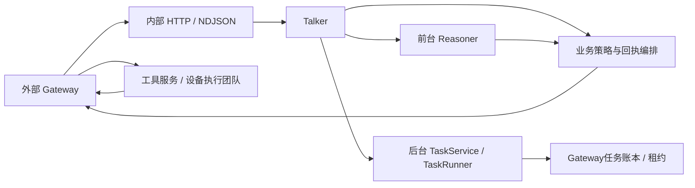

# NLP Agent Harness

本仓库交付独立NLP服务。Gateway提供鉴权后的原话、结构化历史、车况、能力及任务版本；NLP负责理解、规划、工具编排和表达。Gateway保存上下文与checkpoint并转交工具请求，设备团队执行动作并提供真实回执。

## 运行链路



生产入口为`backend.nlp_app:configured_app`，组合根为`backend/harness/assembly.py`。生产服务不启动Demo会话actor、SQLite、ASR/TTS、WebSocket或模拟器。

| 模块 | 职责 |
| --- | --- |
| `harness/context.py`、`talker.py` | 稳定前缀、历史选择、动态快照与固定26工具 |
| `harness/contracts.py`、`run.py` | 版本化运行、流式模型、预算、工具组校验、挂起与恢复 |
| `harness/gateway.py` | Gateway输入编译、子运行编排、完整交接与诊断 |
| `harness/product_policy.py` | 来源约束、任务选择、媒体/导航准备、回执状态转换 |
| `harness/vehicle_planner.py` | skill证据、intent账本、计划结构/来源/保持约束校验 |
| `harness/foreground.py` | Planner子动作与领域依赖按真实回执推进，记录执行账本 |
| `harness/background.py`、`task_runner.py` | 任务登记、修订、执行、澄清、检索、收尾 |
| `harness/task_transport.py` | Gateway任务账本的HTTP适配器；revision CAS、执行租约、追踪 |
| `harness/release.py`、`diagnostics.py` | 发布指纹、模型策略版本、脱敏诊断 |

热车控成功后直接消费回执完成，不再额外调用Talker。查询、失败或需要表达的结果仍回到模型。复杂车控在NLP内部规划，不向Gateway发送“请调用Planner”占位请求。计划动作逐项交接；前一控制动作没有真实结果及后续所需的新车况时，不继续推导执行。

媒体支持play/pause/resume/stop/exit/next/previous/seek/volume/get_status；导航支持start/get_status/route/set_origin/add_waypoint/remove_waypoint/cancel。依赖动作在收到前序真实回执后重新准备。`expected`是命令预期，不能直接推进事实状态。执行地点由部署bindings与Gateway能力事实共同约束。

后台任务由NLP调用Gateway任务账本登记，真实确认后才报告已登记；Gateway获得执行租约后调用NLP执行接口。TaskRunner复用既有quick/research、澄清、修订、来源约束和收尾规则；不自行抢占任务或写SQLite。Gateway负责暂停澄清计时、过期、唯一执行者和状态/事件原子性。任务回流通过present接口再次读取实际任务，核对revision/status后生成带event_key的播报和结果卡；人设表达使用模板，不增加模型调用。

## 配置与启动

```sh
.venv/bin/python -m scripts.validate_prompt_config
.venv/bin/python -m scripts.validate_service_config
.venv/bin/python -m uvicorn backend.nlp_app:configured_app --factory --host 127.0.0.1 --port 8001
```

使用现有`config/services.toml`选定四个模型角色（Talker、前台Planner、后台Thinker及其finalizer）。前三份主prompt与四个模型配置角色不是一一对应的Agent数量；finalizer是后台任务的收尾阶段。

| 配置 | 用途 |
| --- | --- |
| `NLP_GATEWAY_URL` | 必填，Gateway内部任务账本和诊断服务根地址 |
| `NLP_GATEWAY_TOKEN` | 可选，内部服务Bearer凭证；网络身份也可由部署层承担 |
| `NLP_GATEWAY_TIMEOUT_SECONDS` | 单次Gateway请求超时，默认10秒 |
| `NLP_MAX_BODY_BYTES` | 入站完整JSON上限，默认8 MiB，含chunked请求 |
| `NLP_MAX_INFLIGHT` | 每进程同时推进的请求上限，默认32；超限429 |
| `NLP_REQUEST_TIMEOUT_SECONDS` | 单次HTTP推进期限，默认120秒，与模型预算独立 |
| 既有模型、搜索、天气配置 | 仅创建NLP所需客户端；缺凭证明确失败，不生成替代结果 |

内部接口只应对受信任Gateway开放；终端不直接调用，也不上传checkpoint。生产流式代理需关闭缓冲。进程内取消只影响本实例正在运行的请求，跨实例路由/租约属于Gateway。完整接入约定见[Gateway V1契约](GATEWAY_CONTRACT.md)。

## Prompt维护

行为主入口收拢为：

- `prompts/talker.md`：职责、决策、工具、表达、三种人设及动态上下文模板。
- `prompts/reasoner_foreground.md`：前台车控规划和结构化纠错阶段。
- `prompts/reasoner_background.md`：共同规则、quick/research、澄清/修订、收尾及来源选择。

每份按命名section维护，启动校验重复/缺失/多余section及变量。请求只选取该阶段需要的section，不把整份后台文档每轮都发送。人设表达边界与选中风格组合；车况、音区、时间、任务等继续以动态上下文传入。

工具说明TOML、原生few-shot JSON、固定播报TOML和embedding指令保持独立。结构化示例未因文件合并被改写。详细索引及统计CLI见[prompts/README.md](../prompts/README.md)。

## Demo与清理边界

`backend/app.py`、`session.py`、`worker.py`、`db.py`及前端保留为仍在使用的本地验证适配器。它们消费同一份NLP上下文、前台Planner、后台TaskRunner和共享领域规则。`worker.py`只负责本地SQLite调度，不再复制后台推理核心。

旧`backend/vehicle_planner.py`已移动到harness，调用方直接引用新模块，不保留转发壳。被替代的碎片prompt、旧Planner/Thinker未来方案和重复历史说明已删除；仍有效的服务接口、车书资料和实测记录保留。不会为了删除旧名字而破坏仍在使用的Demo测试入口。

## 验证边界

离线测试覆盖协议严格校验、来源与能力、前后台编排、真实回执格式、版本/预算/取消、Gateway HTTP适配、流式断线及部署装配。测试中的模型、HTTP响应和设备回执均为显式测试替身，不是产品回退路径。

评测入口与运行服务统一使用`create_llm()`，遵循所选服务配置、profile凭证及角色模型；报告保存配置来源和实际模型。显式模型实验与历史capture回放保留指定模型，凭证仍来自所选profile。HTTP失败读取响应体并保留脱敏后的供应商错误码、原因和请求ID，不能仅凭403断言整个项目的模型服务不可用。

文件合并的字符差异不等于token和延迟收益。此前30组固定时钟对照用于确认最初抽取保真；三主prompt整理后system内容有意变化，应使用新的capture/compare报告，不能继续宣称全部请求逐字相同。

Gateway契约按目标接口实现，尚未经外部团队联调；当前可做本地合同测试和集成模拟，真实Gateway、真实设备结果及部署网络条件仍须在对接环境验证。这不影响本仓库内生产入口、业务策略和前后台调度实现的完整交付。

### 本轮验证记录（2026-10-17）

- 403排查修复后全量后端：1711 passed（30.30秒）；重构阶段前端：102 passed，TypeScript/Vite构建通过。
- Prompt、服务配置校验与`git diff --check`通过；独立uvicorn进程启动并返回真实health响应，未调用外部模型或Gateway。
- 30组固定时钟capture对照保留消息数、模型参数、工具定义、非system消息和104条原生示例。角色规则有意变化：Talker每请求减少353字符，research减少314，quick增加18，前台主规则增加59；这不是token或延迟测量。
- 前台离线审计：1次Talker、1次Planner、2个独立执行回执，最终completed，8批HTTP诊断；未用计划/预检替代回执。完整轨迹为本机忽略文件`data/evals/nlp-final-orchestration-trace.json`。
- 后台HTTP合同测试覆盖实际适配器注册、租约、澄清、revision更新、继续执行和呈现；过期呈现不输出播报，未知写入不自动重试。
- 更正原9次HTTP403探针：旧评测绕过服务配置，默认读取`ARK_API_KEY`；该凭证返回`AccountOverdueError`（账号欠费）。项目实际profile使用另一个凭证变量，真实调用成功。旧失败不代表项目所选模型服务不可用，也不构成行为或延迟基线。
- 修复后闲聊专项：三个人设各3次，9/9通过，无HTTP403；首句P50/P90为2034/4539ms，平均每轮1次模型调用。结果位于本机忽略文件`data/evals/nlp-configured-provider-probe.json`，仅代表这9次请求，不是全量行为、语音或真车验收。
- 同一批9条回复用配置中的后台模型做话术辅助审查，全部获得评分，平均4.89/5；这是模型辅助评分，不替代人工验收，结果为`data/evals/nlp-configured-provider-probe.speech.json`。
- 温控/前台Reasoner首次补测6次中3次通过、3次出现`ProviderError`；旧报告缺详细轨迹，无法仅凭约20.5秒耗时判定具体网络原因。原报告保留为`data/evals/nlp-configured-control-probe.json`。现已在临时数据库删除前导出完整脱敏trace，逐轮保留供应商错误、实际请求和回执。
- 带trace的顺序复测6/6通过：首句P50/P90为2135/2672ms，每轮Talker调用1次；三个前台Reasoner场景各再调用1次Pro，合计9次模型调用。实际使用Mini `doubao-seed-2-0-mini-260428`与Pro `doubao-seed-2-1-pro-260915`；模拟设备回执均已记录。报告为`data/evals/nlp-configured-control-traced-probe.json`，不能用复测通过抹去前一轮失败。
- 恢复原并发设置复测6/6通过：首句P50/P90为2340/3413ms，同样共9次模型调用，详见`data/evals/nlp-configured-control-concurrent-trace.json`。未再出现403，也未复现前三次连接类失败；这些有限样本不证明并发稳定性已验收。
