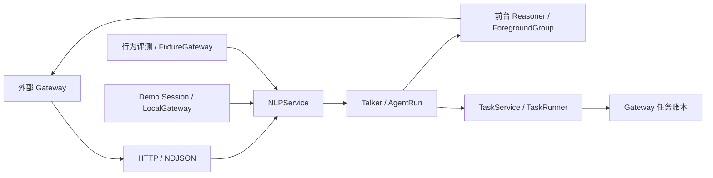

# NLP Agent Harness

本仓库交付独立 NLP 服务：理解原话、构造模型上下文、规划、编排工具、生成表达。Gateway 负责身份与会话、上下文和 checkpoint 持久化、任务账本/租约、工具交接；工具和设备团队负责真实执行及回执。生产 NLP 不启动 SQLite、Demo actor、ASR/TTS、模拟器或设备连接。

## 核心与适配器



| 模块 | 实际职责 |
| --- | --- |
| `backend/nlp_app.py`、`harness/assembly.py` | 生产入口、生命周期、冻结配置、资源装配 |
| `harness/gateway_contracts.py` | Gateway 输入/输出、结构化历史、checkpoint v2 的严格 wire 模型 |
| `harness/contracts.py`、`ports.py` | 内部运行数据与策略、诊断、前台宿主端口 |
| `harness/gateway.py` | NLPService 编译、恢复、前后台组合与交接 |
| `harness/run.py`、`model_execution.py` | Agent 循环与预算；共享模型结果/usage 归一、取消及流关闭原语 |
| `harness/context.py`、`talker.py` | 历史选择、固定前缀、能力投影与固定 26 工具 |
| `harness/product_policy.py`、`foreground.py` | 来源/权限与精确参数、真实回执推进依赖、未知结果等待 |
| `harness/vehicle_planner.py` | 前台计划、skill 证据、intent/动作账本及保持约束 |
| `harness/background.py`、`task_runner.py` | 后台任务登记、修订、执行、澄清、检索、收尾、版本化呈现 |
| `harness/evidence.py` | 来源/版本/内容指纹、证据范围、跨恢复的检索进展 |
| `harness/task_transport.py`、`task_store.py` | Gateway 任务存储端口及 HTTP 适配 |
| `harness/release.py`、`diagnostics.py`、`observability.py` | 发布指纹、脱敏批量追踪、进程指标及可选就绪探测 |

wire 模块不导入运行器、执行器或存储实现；它复用共享严格模型与纯编译/证据类型。`ports.py` 描述业务策略和宿主边界，前台编排不反向导入 GatewayRun。模型调用原语只统一协议，不把前台动作账本与后台任务状态机强行合成同一个循环。

Demo 的 `SessionActor` 经 `demo/session_nlp.py` 与 `demo/local_gateway.py` 驱动同一个 NLPService。它保留输入、音频播放、界面、实际模拟器回执和 SQLite 调度适配；不再实现另一份模型路由/业务工具循环。行为评测的 `evals/gateway_driver.py` 同样提交 StartRequest、保存交接并回传显式 fixture 的执行结果。生产核心不得反向导入这些适配器，`scripts/check_import_boundaries.py` 同时检查静态与实际导入。

## 执行、上下文与恢复

Talker 一次调用决定并表达。咨询与执行由模型理解，代码校验结构、来源、能力与回执，不追加每轮意图分类模型。纯控制/登记的确定成功直接消费回执完成；查询及需要解释的失败按真实结果继续推理。前台 Planner 只产出计划，ForegroundGroup 验证完整动作并逐项交接；媒体/导航依赖必须在前序真实回执后重新准备，不能用 expected 状态推进。

模型输入中的整车回执可投影为相对本轮车况快照的无损 `vehicle_state_delta`：基准含 revision、观测时间和内容指纹，set/remove 保留该回执当时的完整差异及原回执身份。历史状态不能当作最新事实；基准不完整时保留原值。真实观察、执行依赖、保持项校验和 checkpoint 仍使用完整回执，模型副本的压缩不能改变执行依据。

历史 assistant 内容保留完整生成答案，`playback_history` 单独表达未知、未开始、部分、完成和已确认听到的片段。未知播放不能当作空答案。动态事实在固定规则、人设、原生示例和历史之后，先列当前音区和变化标志。Talker 的固定前缀从catalog文字配置生成85项完整冷能力语义说明，仍只有26工具；动态冷车控索引按 skill 保留 available/unavailable/missing 名称及可用数量，不从语义目录或 feature=true 推断缺失能力。完整声明保留在 StartRequest，供前台编排与执行校验使用。

检索结果的来源 ID、版本和内容指纹用于判断有无新增证据；排序、分数和再次查询时间不算新证据。证据范围描述对象、时段、粒度及覆盖范围，不证明答案被支持。首个空结果允许一次改写；再次无新增证据会阻止继续调用同一检索工具，返回可收束的结构化反馈。前台默认每工具最多 4 次、合计 8 次；后台同时受任务步骤/查询预算约束。进展账本随运行/任务 checkpoint 保存，unknown 结果不当作确定证据。

Gateway wire 使用 `gateway-v1`，其中 `run.checkpoint_version=2`：原 StartRequest 保存一次，后续仅保存本轮生成消息、运行计数、交接和回执账本；固定 prompt/schema/history 前缀由同版本编译器重建，并校验 prepared_digest。子编排车况保存相对初始车况的领域差量。源码/prompt、冻结模型及执行配置、业务策略任一版本不匹配均拒绝恢复；旧 v1 运行 checkpoint 不隐式转换。完整追踪另走诊断存储，不能以删审计来控制 checkpoint 体积。

默认 HTTP body 上限 8 MiB；StartRequest 上限 6 MiB；checkpoint 非 Start 部分上限 1 MiB；单批回执上限 256 KiB。接收回执前还检查剩余续跑空间，超限不接受任何回执。接口不静默截断业务内容；Gateway 应保留已确认交接与执行结果，不能因超限重新执行动作。精确字段和失败语义见 [Gateway 契约](GATEWAY_CONTRACT.md)。

后台 TaskService 调用 Gateway 账本登记，确认提交后才报告 registered。Gateway 获取执行租约后调用 execute；澄清、修订、过期与状态/事件原子性属于 Gateway。present 重新读取 revision/status，匹配时返回可去重 event_key、播报与卡片，不增加模型调用；建议操作不构成执行授权。

## 配置与启动

```sh
uv sync --frozen --no-dev
NLP_GATEWAY_URL=http://gateway.internal .venv/bin/python -m uvicorn backend.nlp_app:configured_app --factory --host 127.0.0.1 --port 8001
```

依赖与 Python 版本由 `pyproject.toml`、`uv.lock` 锁定；生产只需基础依赖，Demo、车书索引和本地 VAD 为独立 extras。生产 factory 显式读取环境构造不可变 NLPSettings，不隐式加载 `.env`；Demo 和脚本的显式入口可调用本地环境加载器。模型/检索使用 `config/services.toml` 及已选择的本地配置，启动时解析并冻结，凭证不写入版本哈希或诊断。

`SERVICE_REGION=europe/china` 在启动加载配置时应用 `config/regions.toml`，绑定四个模型角色与 Demo 的 ASR/TTS；生产 NLP 进程仍不启动音频服务。欧洲使用 Google EU Gemini 3.8 Flash、ElevenLabs ASR 和火山小何 TTS，中国使用 Ark/火山音频；ElevenLabs 和 Google TTS 保留为显式可选实现。未设置时使用所选服务文件的显式绑定，仓库基础绑定仍为火山；本机 `.env` 选择欧洲不会改变此默认规则。预设不改 token、推理与超时预算，也不改检索、地图或媒体。选中地区时不接受 `ASR_PROFILE` / `TTS_PROFILE` 覆盖，不识别 IP，不跨地区自动回退。详情与凭证要求见[地区预设](SERVICE_PROVIDERS.md#地区预设)。

更改地区后重启相关进程并新建运行；有效角色/profile 配置进入模型策略指纹，旧 checkpoint 和后台任务不能用新配置续跑。运行过程中修改环境变量不会切换已装配的模型。地区名称是部署选择，不代表所有第三方服务都承诺同一数据处理辖区。

| 环境变量 | 用途/默认值 |
| --- | --- |
| `SERVICE_REGION` | 可选 `europe` / `china`；启动冻结，未设置使用显式绑定 |
| `NLP_GATEWAY_URL`、`NLP_GATEWAY_TOKEN` | Gateway 根地址必填；内部 Bearer 凭证可选 |
| `NLP_GATEWAY_TIMEOUT_SECONDS` | Gateway 单次请求 10 秒 |
| `NLP_GATEWAY_HEALTH_URL` | 可选显式健康 URL；未设置则不探测 Gateway |
| `NLP_READINESS_TIMEOUT_SECONDS`、`NLP_READINESS_CACHE_SECONDS` | 就绪探测 2 秒、缓存 5 秒；不调用模型 |
| `NLP_MAX_BODY_BYTES`、`NLP_BODY_TIMEOUT_SECONDS` | HTTP body 8 MiB、接收 30 秒 |
| `NLP_MAX_INFLIGHT`、`NLP_REQUEST_TIMEOUT_SECONDS` | 每进程 32 并发、单次推进 120 秒 |
| `THINKER_MAX_STEPS`、`THINKER_TIMEOUT_SECONDS`、`TOOL_TIMEOUT_SECONDS` | 后台默认 20 步、60 秒、单工具 12 秒；启动冻结 |

`/health/live` 只报告进程存活；`/health/ready` 报告本地资源和可选 Gateway 探测及发布版本；`/metrics` 返回按模型角色聚合的调用、失败/取消、时长和实际 usage，不保存对话文本。未知 token 数不伪造为已测量。内部接口须由部署层隔离，流式代理关闭缓冲；跨实例排他和取消路由由 Gateway 管理。

角色级模型首输出和累计期限见[服务配置](SERVICE_PROVIDERS.md)。流式重试共用原期限，超时不自动重发；`attempts` 保留每次尝试，顶层 elapsed/首包/首文本按逻辑调用累计。设定期限只能限制等待；冷缓存下的成功响应延迟和失败率仍须独立验收，不能把快速失败当作提速。

当前指标为进程内 JSON 聚合，尚未接入 OpenTelemetry/Prometheus exporter，也未覆盖首 token 延迟和策略拒绝分布；这些需随部署监控补齐。压测、滚动升级和真车联调仍需在实际 Gateway 与设备环境验收。checkpoint 当前不使用 HMAC，依赖可信内部接口及 Gateway 服务器存储边界；若允许终端或其他不可信主体回传，须先增加认证签名或改成服务端引用。

## Prompt 与验证

行为主入口仍只有 `talker.md`、`reasoner_foreground.md`、`reasoner_background.md`。启动严格校验命名 section 与变量，请求只选择角色/阶段/当前人设所需内容。工具文字 TOML、104 条原生示例消息（34 个调用）、固定播报和 embedding 指令保持独立，详见 [Prompt 索引](../prompts/README.md)。

```sh
.venv/bin/python -m scripts.validate_prompt_config
.venv/bin/python -m scripts.validate_service_config
.venv/bin/python -m scripts.check_import_boundaries --smoke-startup
.venv/bin/python -m pytest -q
```

`evals.harness` 经生产 NLPService 评估精确参数、禁止动作、检索次数与跨人设差异；`general_principles.json` 先定义咨询/执行、证据范围、播放追问及无进展收束场景。带 rubric 的轮次自动用独立配置模型逐项审查并保存原文依据、脱敏原始响应和错误原因，供应商/解析失败记为 unreviewed，不能算语义通过；人工抽查仍然必要。它不是生产路径里的串行模型调用。

当前离线30请求对照为 `data/evals/final-capability-catalog-before.json` 与 `final-capability-catalog-frozen.json`，统计在 `final-capability-catalog-frozen-statistics.json`。固定冷能力目录增加语义信息，渲染core由6,838增至11,026字符；消息数、工具结构和104条原生示例不变，工具文字纠正了旧Demo执行假设。此前同一125条能力事实的结构投影使快照27,710→13,377字符，两项变化需分别衡量，不能只报压缩收益。token与延迟以最终真实评测的供应商usage为准，不用字符换算。

此前真实模型探针、话术审查和供应商故障记录保留在本机忽略目录 `data/evals/nlp-configured-*`，属于当时版本和有限样本，不充当本轮验收。外部 Gateway 尚未联调，离线合同测试与模拟回执不能证明真车执行或部署网络已验收。

终态的固定表达由`harness/presentation.py`统一生成并保存在checkpoint；Demo与评测消费同一个presentation。它只引用真实执行状态或已确认任务登记；参数目标不能代替实际状态。模型已有对应预告或最终答案时不追加重复播报，原始模型返回独立保留。Demo后台Worker与前台注册使用同一份冻结模型及预算指纹，旧或缺登记版本任务明确失败且不调用模型。
