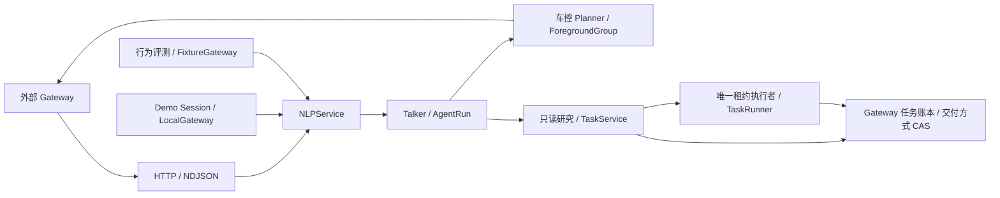

# NLP Agent Harness

本仓库交付独立 NLP 服务：理解原话、构造模型上下文、规划、编排工具、生成表达。Gateway 负责身份与会话、上下文和 checkpoint 持久化、任务账本/租约、工具交接；工具和设备团队负责真实执行及回执。生产 NLP 不启动 SQLite、Demo actor、ASR/TTS、模拟器或设备连接。

## 核心与适配器



| 模块 | 实际职责 |
| --- | --- |
| `src/super_xd/nlp/api/app.py`、`src/super_xd/nlp/assembly.py` | 生产入口、生命周期、冻结配置、资源装配 |
| `src/super_xd/nlp/contracts/gateway_v1.py` | Gateway 输入/输出、结构化历史、checkpoint v2 的严格 wire 模型 |
| `src/super_xd/nlp/contracts/run.py`、`src/super_xd/nlp/orchestration/ports.py` | 内部运行数据与策略、诊断、前台宿主端口 |
| `src/super_xd/nlp/orchestration/gateway.py` | NLPService 编译、恢复、前后台组合与交接 |
| `src/super_xd/nlp/engine/run.py`、`src/super_xd/nlp/engine/models.py` | Agent 循环与预算；共享模型结果/usage 归一、取消及流关闭原语 |
| `src/super_xd/nlp/prompts/context.py`、`src/super_xd/nlp/orchestration/talker.py` | 历史选择、固定前缀、能力投影与固定 26 工具 |
| `src/super_xd/nlp/policy/product.py`、`src/super_xd/nlp/orchestration/foreground.py` | 来源/权限与精确参数、真实回执推进依赖、未知结果等待 |
| `src/super_xd/nlp/orchestration/vehicle_planner.py`、`src/super_xd/nlp/policy/vehicle.py` | 前台模型调用与车控计划校验；结构 schema 在 `catalog/vehicle_plan.py`，模型文案在 `prompts/vehicle_plan.py` |
| `src/super_xd/nlp/orchestration/tasks/` | 只读任务登记、前台等待、后台交付、修订、澄清、收尾与呈现；`runner.py`推进流程，`tools.py`组合查询端口，状态/checkpoint在`contracts/task_state.py` |
| `src/super_xd/nlp/catalog/research.py`、`prompts/research.py`、`policy/research.py` | 研究工具结构、文字编译和无IO结果校验 |
| `src/super_xd/nlp/contracts/providers.py`、`adapters/models/` | 类型化模型请求/结果/事件、角色绑定、共用HTTP/SSE及供应商编码认证 |
| `src/super_xd/nlp/contracts/events.py`、`policy/speaking.py` | 版本化通知事实和纯播报仲裁；队列及交付由Gateway或Demo持有 |
| `src/super_xd/nlp/engine/evidence.py` | 来源/版本/内容指纹、证据范围、跨恢复的检索进展 |
| `src/super_xd/nlp/adapters/gateway/tasks.py`、`src/super_xd/nlp/orchestration/tasks/ports.py` | Gateway 任务存储端口及 HTTP 适配 |
| `src/super_xd/nlp/release.py`、`diagnostics.py`、`observability.py` | 发布指纹、脱敏批量追踪、进程指标及可选就绪探测 |

wire 模块只包含共享严格模型和数据校验，不导入 prompt、运行器、执行器或存储实现。历史消息转换由 `nlp/prompts/compiler.py` 完成。`orchestration/ports.py` 描述业务策略和宿主边界，前台编排不反向导入 GatewayRun。模型调用原语只统一协议，不把前台动作账本与后台任务状态机强行合成同一个循环。

Demo 的 `SessionActor` 经 `demo/session/nlp.py` 与 `demo/gateway.py` 驱动同一个 NLPService。它保留输入、音频播放、界面、实际模拟器回执和 SQLite 调度适配；不再实现另一份模型路由/业务工具循环。行为评测的 `evals/gateway_driver.py` 同样提交 StartRequest、保存交接并回传显式 fixture 的执行结果。生产核心不得反向导入这些适配器，`scripts/check_import_boundaries.py` 同时检查静态与实际导入。

## 模型端口

`ModelRequest`包含messages/tools、角色及可收紧的推理/token/时间选项。`ModelService.resolve()`按启动冻结配置绑定实际模型，拒绝与该角色不符的模型覆盖；`complete(request)`返回独立的`ModelResult(message, metadata)`，`stream(request)`输出类型化`ModelEvent`（delta或最终message/meta）。`engine/models.py`再校验响应、提取实际usage并保留原始诊断。元信息不塞回assistant消息，不接受旧多参数调用协议。

`ChatCompletionsTransport`统一SSE组装、总期限/首输出期限、有限重试、取消和连接关闭；Ark、Vertex、Compatible适配器负责自己的认证与payload。Vertex ADC也处于同一累计调用预算内。工具组仍待完整响应和业务校验后才执行，JSON片段闭合不是执行授权。Tavily查询位于`adapters/reads/tavily.py`，不依赖模型传输实现。

模型返回的工具级`extra_content`和assistant顶层续推字段均保留。历史使用`AssistantRecord.provider_metadata={extra_content: ...}`承载顶层数据；编译回模型原生位置，不能由Gateway合成或改写签名，也不作为设备权限。

模型响应进入运行层时，工具调用缺省或空串的`arguments`统一规范为`"{}"`，之后仍按工具schema校验必填参数。运行、恢复、呈现和Demo历史消费同一份规范消息；非空非法JSON及非对象参数仍被拒绝，供应商原始返回保留在独立诊断的`raw_return`中。

## 执行、上下文与恢复

Talker 一次调用决定并表达。咨询与执行由模型理解，代码校验结构、来源、能力与回执，不追加每轮意图分类模型。纯控制/登记的确定成功直接消费回执完成；查询及需要解释的失败按真实结果继续推理。前台 Planner 只产出计划，ForegroundGroup 验证完整动作并逐项交接；媒体/导航依赖必须在前序真实回执后重新准备，不能用 expected 状态推进。

模型输入中的整车回执可投影为相对本轮车况快照的无损 `vehicle_state_delta`：基准含 revision、观测时间和内容指纹，set/remove 保留该回执当时的完整差异及原回执身份。历史状态不能当作最新事实；基准不完整时保留原值。真实观察、执行依赖、保持项校验和 checkpoint 仍使用完整回执，模型副本的压缩不能改变执行依据。

历史 assistant 内容保留完整生成答案，`playback_history` 单独表达未知、未开始、部分、完成和已确认听到的片段。未知播放不能当作空答案。动态事实在固定规则、人设、原生示例和历史之后，先列当前音区和变化标志。Talker 的固定前缀从catalog文字配置生成85项完整冷能力语义说明，仍只有26工具；动态冷车控索引按 skill 保留 available/unavailable/missing 名称及可用数量，不从语义目录或 feature=true 推断缺失能力。完整声明保留在 StartRequest，供前台编排与执行校验使用。

检索结果的来源 ID、版本和内容指纹用于判断有无新增证据；排序、分数和再次查询时间不算新证据。证据范围描述对象、时段、粒度及覆盖范围，不证明答案被支持。首个空结果允许一次改写；再次无新增证据会阻止继续调用同一检索工具，返回可收束的结构化反馈。前台默认每工具最多 4 次、合计 8 次；后台同时受任务步骤/查询预算约束。进展账本随运行/任务 checkpoint 保存，unknown 结果不当作确定证据。

Gateway wire 使用 `gateway-v1`，其中 `run.checkpoint_version=2`：原 StartRequest 保存一次，后续仅保存本轮生成消息、运行计数、交接和回执账本；固定 prompt/schema/history 前缀由同版本编译器重建，并校验 prepared_digest。子编排车况保存相对初始车况的领域差量。源码/prompt、冻结模型及执行配置、业务策略任一版本不匹配均拒绝恢复；旧 v1 运行 checkpoint 不隐式转换。完整追踪另走诊断存储，不能以删审计来控制 checkpoint 体积。

车控规划的完整模型请求/响应、技能加载资料和中间事件通过`orchestration.event`送到独立诊断sink。`VehiclePlan`只保留身份、预算、加载技能标识、来源、校验与动作账本等业务状态；`model_observations/load_evidence/trace_events`不进入计划、工具结果或checkpoint，避免把整份prompt/schema随每次交接重复保存。

默认 HTTP body 上限 8 MiB；StartRequest 上限 6 MiB；checkpoint 非 Start 部分上限 1 MiB；单批回执上限 256 KiB。接收回执前还检查剩余续跑空间，超限不接受任何回执。接口不静默截断业务内容；Gateway 应保留已确认交接与执行结果，不能因超限重新执行动作。精确字段和失败语义见 [Gateway 契约](GATEWAY_CONTRACT.md)。

## 同一研究任务的前后台交付

`delegate_task.mode`选择`foreground/background`，`query_mode`独立选择`quick/research`；同一TaskRunner和只读工具协议支持两种交付方式。研究只查询资料并形成中性结果/建议，不执行设备动作，也不读取人设。车控规划仍走独立Planner与回执状态机。

TaskService先向Gateway登记，确认后才报告registered。Gateway取得执行租约并调用`/v1/tasks/execute`；前台调用只等待这个任务，默认软等待8秒（`NLP_FOREGROUND_WAIT_SECONDS`，范围`(0,30]`）。完成或澄清时使用真实快照交付；等待到期时通过账本`delivery-mode` CAS把同一task_id改为后台交付，不新建任务、不重新开始研究、不修改revision、当前checkpoint、来源或累计预算。

该切换只解除前台等待，原执行者与租约保持不变。切换事务必须和checkpoint写入串行化，并原子记录delivery_changed事件；正在进行的只读请求可由原执行者继续完成和保存。本轮不实现跨worker租约移交、持久消息总线或生产任务调度器。Gateway仍须提供唯一执行者及恢复机制，Demo由独立SQLite Worker实现。

登记ACK一旦确认，TaskCommit即保持confirmed；后续等待或交付读取失败单独报告`task_delivery_unconfirmed`，不能把已登记任务降回unknown。

用户打断/断线取消等待时，TaskService会有限时地尝试解除前台交付；结果不确定只留诊断，不能自动重复写入或重新登记。用户取消研究任务仍需独立cancel mutation。reply/update产生新revision，旧结果只留审计；版本、租约、澄清和期限检查继续生效。模型供应商超时属于执行失败，不等同于前台等待到期。

`present`重新读取revision/status，匹配时返回稳定event_key、播报与卡片，不增加模型调用。前后台共用task_presentation，按read_details选择口语摘要或清理格式后的全文。前台已交付的结果按任务版本去重，避免再主动播报；建议动作不构成执行授权。

## 通知与Demo生命周期

`TaskNotice`保留事件ID、任务版本/状态、类型、优先级和显式有效期。纯策略`decide_presentation`返回`speak/defer/screen_only/drop`：过期或旧版本丢弃，普通进度只上屏；断线、用户/助手说话、正在生成、通话或繁忙驾驶时延后。澄清优先，接近截止时间的澄清先于普通结果。事实由Gateway或Demo输入，模型不猜通话或驾驶状态。事件表达保持确定性模板，未增加常规模型调用。

Demo的NotificationQueue由actor单写者管理，重复事件不延长有效期，旧播报完成不能删掉更新的通知。获取展示数据的瞬时失败从0.25秒指数退避至最多15秒，并受通知TTL约束；已交付、过期或过时的迟到回调丢弃。AudioBridge负责音频事件适配；异步工作仍post事件回`SessionActor.handle()`修改状态。

`SessionRegistry`每60秒检查一次无控制/音频连接、无生成且没有queued/running/cancelling/waiting_clarification任务的会话；最后活动超过1800秒时关闭并移除。`DELETE /api/sessions/{id}`也可显式关闭。关闭释放会话资源，SQLite审计与任务记录保留；本地内存会话不会在重启/回收后自动恢复。

## 配置与启动

```sh
uv sync --locked --no-dev
NLP_GATEWAY_URL=http://gateway.internal .venv/bin/python -m uvicorn super_xd.nlp.api.app:configured_app --factory --host 127.0.0.1 --port 8001
```

依赖与 Python 版本由 `pyproject.toml`、`uv.lock` 锁定；生产只需基础依赖，Demo、车书索引和本地 VAD 为独立 extras。生产 factory 显式读取环境构造不可变 NLPSettings，不隐式加载 `.env`；Demo 和脚本的显式入口可调用本地环境加载器。模型/检索使用 `config/services.toml` 及已选择的本地配置，启动时解析并冻结，凭证不写入版本哈希或诊断。

`SERVICE_REGION=europe/china` 在启动加载配置时应用 `config/regions.toml`，绑定四个模型角色与 Demo 的 ASR/TTS；生产 NLP 进程仍不启动音频服务。欧洲使用 Google EU Gemini 3.8 Flash、ElevenLabs ASR 和火山小何 TTS，中国使用 Ark/火山音频；ElevenLabs 和 Google TTS 保留为显式可选实现。未设置时使用所选服务文件的显式绑定，仓库基础绑定仍为火山。预设不改 token、推理与超时预算，也不改检索、地图或媒体。选中地区时不接受 `ASR_PROFILE` / `TTS_PROFILE` 覆盖，不识别 IP，不跨地区自动回退。详情与凭证要求见[地区预设](SERVICE_PROVIDERS.md#地区预设)。

更改地区后重启相关进程并新建运行；有效角色/profile 配置进入模型策略指纹，旧 checkpoint 和后台任务不能用新配置续跑。运行过程中修改环境变量不会切换已装配的模型。地区名称是部署选择，不代表所有第三方服务都承诺同一数据处理辖区。

| 环境变量 | 用途/默认值 |
| --- | --- |
| `SERVICE_REGION` | 可选 `europe` / `china`；启动冻结，未设置使用显式绑定 |
| `NLP_GATEWAY_URL`、`NLP_GATEWAY_TOKEN` | Gateway 根地址必填；内部 Bearer 凭证可选 |
| `NLP_GATEWAY_TIMEOUT_SECONDS` | Gateway 单次请求 10 秒 |
| `NLP_GATEWAY_HEALTH_URL` | 可选显式健康 URL；未设置则不探测 Gateway |
| `NLP_READINESS_TIMEOUT_SECONDS`、`NLP_READINESS_CACHE_SECONDS` | 就绪探测 2 秒、缓存 5 秒；不调用模型 |
| `NLP_MAX_BODY_BYTES`、`NLP_BODY_TIMEOUT_SECONDS` | HTTP body 8 MiB、接收 30 秒 |
| `NLP_MAX_INFLIGHT`、`NLP_REQUEST_TIMEOUT_SECONDS` | 每进程 32 并发、单次推进 120 秒 |
| `NLP_FOREGROUND_WAIT_SECONDS` | 只读任务前台软等待8秒，`(0,30]`；进入model_policy_id，改变须新运行 |
| `THINKER_MAX_STEPS`、`THINKER_TIMEOUT_SECONDS`、`TOOL_TIMEOUT_SECONDS` | 后台默认 20 步、60 秒、单工具 12 秒；启动冻结 |

`/health/live` 只报告进程存活；`/health/ready` 报告本地资源和可选 Gateway 探测及发布版本；`/metrics` 返回按模型角色聚合的调用、失败/取消、时长和实际 usage，不保存对话文本。未知 token 数不伪造为已测量。内部接口须由部署层隔离，流式代理关闭缓冲；跨实例排他和取消路由由 Gateway 管理。

角色级模型首输出和累计期限见[服务配置](SERVICE_PROVIDERS.md)。流式重试共用原期限，超时不自动重发；`attempts` 保留每次尝试，顶层 elapsed/首包/首文本按逻辑调用累计。设定期限只能限制等待；冷缓存下的成功响应延迟和失败率仍须独立验收，不能把快速失败当作提速。

当前指标为进程内 JSON 聚合，尚未接入 OpenTelemetry/Prometheus exporter，也未覆盖首 token 延迟和策略拒绝分布；这些需随部署监控补齐。压测、滚动升级和真车联调仍需在实际 Gateway 与设备环境验收。checkpoint 当前不使用 HMAC，依赖可信内部接口及 Gateway 服务器存储边界；若允许终端或其他不可信主体回传，须先增加认证签名或改成服务端引用。

## Prompt 与验证

行为模板采用专家的 `common/talker/talker_event/reasoner/reasoner_foreground/reasoner_background/persona/context.md`，优先保留原文叙述，只适配真实工具与运行边界。`vehicle_planner.md` 单独描述只提交计划的协议，`runtime.md` 保存短的重试、修订与收尾消息。前后台研究共享中性结果，不因交付模式改变权限或读取人设；事件仍由确定性路径播报，不新增模型调用。启动严格校验资源清单、命名 section、变量和示例调用；请求读取已缓存模板。工具文字TOML、少量原生示例、固定播报和embedding指令保持独立；资源与示例数量以配置校验报告为准，详见 [Prompt 索引](../prompts/README.md)。

```sh
.venv/bin/python -m scripts.validate_prompt_config
.venv/bin/python -m scripts.validate_service_config
.venv/bin/python -m scripts.check_import_boundaries --smoke-startup
.venv/bin/python -m pytest -q
```

`evals.harness` 经生产 NLPService 评估精确参数、禁止动作、检索次数与跨人设差异；`general_principles.json` 先定义咨询/执行、证据范围、播放追问及无进展收束场景。带 rubric 的轮次自动用独立配置模型逐项审查并保存原文依据、脱敏原始响应和错误原因，供应商/解析失败记为 unreviewed，不能算语义通过；人工抽查仍然必要。它不是生产路径里的串行模型调用。

终态的固定表达由`src/super_xd/nlp/orchestration/presentation.py`统一生成并保存在checkpoint；Demo与评测消费同一个presentation。它只引用真实执行状态或已确认任务登记；参数目标不能代替实际状态。模型已有对应预告或最终答案时不追加重复播报，原始模型返回独立保留。Demo后台Worker与前台注册使用同一份冻结模型及预算指纹，旧或缺登记版本任务明确失败且不调用模型。


## 包与部署资源

源码采用`src/super_xd/`安装布局；禁止依赖仓库根目录的旧模块路径。Hatch构建wheel时将根`prompts/`、`config/services.toml`与`config/regions.toml`装入包资源。`nlp/resources.py`统一处理源码安装、wheel安装和显式`SUPER_XD_RESOURCE_ROOT`，请求路径不读取文件。

发布指纹使用统一的逻辑路径计算生产`nlp/`源码和资源哈希，源码与同内容wheel一致；Demo代码变化不改变生产指纹。默认资源必须随包交付，缺文件拒绝启动。外部服务配置仍通过`SERVICES_CONFIG_PATH`加载并冻结，进入模型策略指纹。

CI分别校验源码依赖边界、离线业务回归，以及实际镜像中的导入/启动。容器只安装核心依赖，不装Demo extras；离线启动只创建客户端并检查本地ASGI接口，不调用模型或Gateway。
