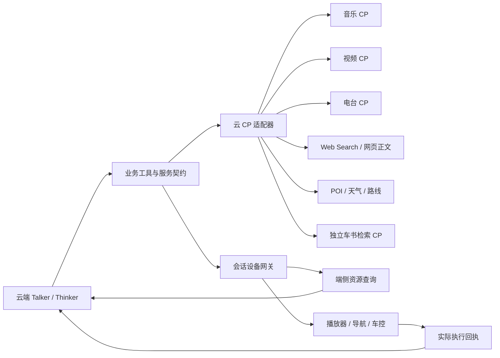

# 可替换服务与 CP 接口

运行配置集中在 `config/services.toml`。提示词、工具说明和播报仍在 `prompts/`；密钥只放环境变量或不提交的 `.env`。改配置后重启 API 和 Thinker。

## 两个独立维度

工具分别声明 `query/control` 和 `cloud/device`。云端 agent 可以直接调用云 CP，也可以通过当前会话的设备网关发起端侧查询。端侧搜索只返回资料；端侧控制必须收到实际执行回执才更新状态。



音乐、视频、电台是三个独立内容来源，可以共用端侧播放器控制协议。曲库、账户和授权仍分别绑定。车书也是独立资源接口：本地 RAG 是一个实现，embedding 是它的内部依赖。

`backend/services/contracts.py` 定义契约，`factory.py` 在进程启动时装配共享客户端并注入业务。`GET /api/services` 返回实际配置、能力和执行位置；`configured` 只表示配置齐全，不等于外部账号、API 开通或服务连通已验证。提供商数量不会增加模型工具数量，Talker 固定为26个工具。

## 已实现的适配器

| 配置域 | 当前实现 | 替换方式 |
|---|---|---|
| `llm` | 火山方舟、Chat Completions 兼容服务 | Talker / Planner / Thinker / Finalizer分别绑定 profile、model、推理开关和输出预算 |
| `asr` | 火山流式、vLLM 音频转写 | 标准 multipart `/v1/audio/transcriptions`，VAD 切段后转写，结果为 final；不假定 FireRed 实时流能力 |
| `tts` | 火山双向流式 | 新厂商实现 TTSProvider，再注册 builder；业务依赖流式 PCM、真实 alignment 和逻辑音色 |
| `web_search` / `web_content` | Tavily、独立 HTTP 网关 | 搜索与正文提取可分别替换 |
| `places` | Google Places、HTTP 网关、端侧查询 | 百度/高德由网关或新适配器做真实字段映射；尚未接通原生百度/高德 SDK |
| `weather` | Google、Open-Meteo、HTTP 网关 | 校验日期、时区、摄氏单位及原始回执；Google 覆盖回退在配置中明确声明 |
| `routes` | Google Routes、HTTP 网关、明确禁用 | 起点来自用户选择或设备真实坐标，不擅自换坐标系 |
| `manual` | 本地车书 RAG、独立 HTTP CP | 远端 CP 不要求本地向量索引；原文和图片仅使用真实返回来源 |
| `embedding` | 火山、兼容 `/embeddings` | 更换模型/维度/指令后重建本地索引 |
| `media.bindings.music` | 腾讯音乐企业网关、通用网关、本地/端侧目录 | 独立音乐 CP |
| `media.bindings.video` | 通用视频 CP 网关、本地/端侧目录 | 独立视频 CP |
| `media.bindings.radio` | 通用电台 CP 网关、本地/端侧目录 | 真实 URL 网络电台；FM 硬件仍是模拟车控 |

HTTP 网关是本项目定义的适配协议，需要你方网关转换实际 CP 的鉴权和字段；它不是厂商公开 API 的声明。缺配置或能力会明确失败，不静默换服务或生成内容。

## 选择配置

普通服务通过 `<DOMAIN>_PROFILE` 选择已有 profile，例如：

```dotenv
ASR_PROFILE=vllm
ASR_BASE_URL=http://你的ASR服务:8000/v1
ASR_MODEL=服务实际暴露的模型名
MANUAL_PROFILE=gateway
MANUAL_GATEWAY_URL=https://你的车书网关
MANUAL_GATEWAY_KEY=只放服务端
```

LLM 角色在 TOML 的 `llm.roles` 修改。兼容服务需要明确填写自己的模型，基础 URL 包含服务实际的 `/v1` 前缀。

常规研究使用 `thinker`；快速任务沿用 `talker` 的速度配置，收尾统一使用 `finalizer`。角色的 `max_tokens` 是上限，收尾调用可再降低；角色关闭 reasoning 时调用方不能重新开启。

音乐、视频、电台分别选择 profile：

```toml
[media.bindings]
music = "tencent"
video = "video_gateway"
radio = "radio_gateway"
```

`MEDIA_MUSIC_PROFILE`、`MEDIA_VIDEO_PROFILE`、`MEDIA_RADIO_PROFILE` 可以单独覆盖。`MEDIA_PROFILE=local` 是显式开发选项，将三种内容都绑定到本地目录；不自动启用、不表示接通 CP。目录和设备协议见 [座舱服务](COCKPIT_SERVICES.md)，实际播放与端侧查询注册见 [前端说明](../frontend/COCKPIT_MEDIA.md)。

内容 ID 带 kind 与 profile 作用域，避免不同 CP 同名 ID 串播。模型只能选择真实搜索结果 ID，适配器或端侧 SDK 解析播放 URL。导航地点保留 provider、原始 ID 和坐标系。

当前Web验证台只调用云侧Routes API并模拟导航设备，不需要Navigation SDK。后续真实车机的逐向导航、GPS位置和偏航事件由端侧导航适配器提供，可以接车机已有导航服务；选择Google原生导航时再集成对应Navigation SDK。

## HTTP 内容网关协议

请求均为 POST JSON，按配置使用 Bearer Key；基础 URL 后追加：

| 域 | 路径 | 请求 |
|---|---|---|
| 网页搜索 | `/v1/web_search/search` | `{query,max_results,include_domains}` |
| 网页正文 | `/v1/web_content/extract` | `{urls}` |
| 地点 | `/v1/places/search` | `{query,max_results,cities_only,near}` |
| 天气 | `/v1/weather/forecast` | `{location,date}` 或 `{city,date,country_code}` |
| 路线 | `/v1/routes/compute` | `{origin,destination,waypoints}` |
| 车书 | `/v1/manual/search` | `{query,max_results}` |
| 各媒体 CP | `/v1/media/search`、`/v1/media/resolve` | `{kind,query,max_results}`、`{content_id}` |

搜索/正文响应含 `results:[{url,title?,content?,raw_content?}]`；地点含 `places:[{place_id,name,location:{latitude,longitude},...}]`。天气和路线必须提供真实测量、日期、时区、单位及来源。完整字段校验见 `backend/services/reads.py`、`routes.py` 和契约测试；车书见 [独立车书接口](MANUAL_PROVIDERS.md)。成功路线查询不代表导航已启动。

## 运行与验证

保留默认8000/5173；独立 worktree 可以运行：

```bash
PORT=8001 FRONTEND_PORT=5174 ./scripts/start.sh
```

数据库、媒体目录和车书索引需要按环境明确设置，两个实验 worker 不应共享数据库。启动脚本按端口设置 `FRONTEND_ORIGIN` / `API_ORIGIN`。

```bash
.venv/bin/python -m scripts.validate_prompt_config
.venv/bin/python -m scripts.validate_service_config
.venv/bin/python -m pytest -q
(cd frontend && node --test tests/*.test.mjs && npm run build)
```

服务验证 CLI 不发外部请求。物理麦克风、回声消除、CP授权与量产车机 SDK 分别验收；离线夹具和浏览器模拟导航不代表这些已通过。

音频详见 [ASR/TTS](AUDIO_PROVIDERS.md)，索引替换详见 [Embedding](EMBEDDING_PROVIDERS.md)。
