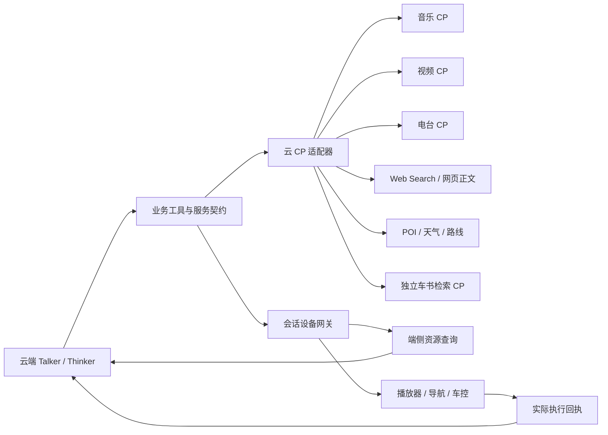

# 可替换服务与 CP 接口

运行配置集中在 `config/services.toml`。提示词、工具说明和播报仍在 `prompts/`；密钥只放环境变量或不提交的 `.env`。改配置后重启 API 和 Thinker。

## 两个独立维度

工具分别声明 `query/control` 和 `cloud/device`。云端 agent 可以直接调用云 CP，也可以通过当前会话的设备网关发起端侧查询。端侧搜索只返回资料；端侧控制必须收到实际执行回执才更新状态。



音乐、视频、电台是三个独立内容来源，可以共用端侧播放器控制协议。曲库、账户和授权仍分别绑定。车书也是独立资源接口：本地 RAG 是一个实现，embedding 是它的内部依赖。

`backend/services/contracts.py` 定义契约，`factory.py` 在进程启动时装配共享客户端并注入业务。`GET /api/services` 返回实际配置、能力和执行位置；`configured` 只表示配置齐全，不等于外部账号、API 开通或服务连通已验证。提供商数量不会增加模型工具数量，Talker 固定为26个工具。

## 已实现的适配器

| 配置域 | 当前实现 | 替换方式 |
|---|---|---|
| `llm` | 火山方舟、Chat Completions 兼容服务、Google Vertex Gemini | Talker / Planner / Thinker / Finalizer分别绑定 profile、model、推理配置和输出预算 |
| `asr` | 火山流式、ElevenLabs Scribe Realtime、vLLM 音频转写 | 流式协议保留 partial/final；vLLM 标准 multipart 接口在 VAD 切段后返回 final，不假定 FireRed 实时流能力 |
| `tts` | 火山双向流式、ElevenLabs Flash、Google Chirp 3 HD | 独立选择音频 profile；统一 PCM 与播放事件，不能把估算时间当真实词级 alignment |
| `web_search` / `web_content` | Tavily、独立 HTTP 网关 | 搜索与正文提取可分别替换 |
| `places` | Google Places、HTTP 网关、端侧查询 | 百度/高德由网关或新适配器做真实字段映射；尚未接通原生百度/高德 SDK |
| `weather` | Google、Open-Meteo、HTTP 网关 | 校验日期、时区、摄氏单位及原始回执；Google 覆盖回退在配置中明确声明 |
| `routes` | Google Routes、HTTP 网关、明确禁用 | 起点来自用户选择或设备真实坐标，不擅自换坐标系 |
| `manual` | 本地车书 RAG、独立 HTTP CP | 远端 CP 不要求本地向量索引；原文和图片仅使用真实返回来源 |
| `embedding` | 火山、兼容 `/embeddings` | 更换模型/维度/指令后重建本地索引 |
| `media.bindings.music` | 腾讯音乐企业网关、通用网关、本地/端侧目录 | 独立音乐 CP |
| `media.bindings.video` | 通用视频 CP 网关、本地/端侧目录 | 独立视频 CP |
| `media.bindings.radio` | 通用电台 CP 网关、本地/端侧目录 | 真实 URL 网络电台；FM 硬件仍是模拟车控 |

HTTP 网关是本项目定义的适配协议，需要你方网关转换实际 CP 的鉴权和字段；它不是厂商公开 API 的声明。缺配置或能力会明确失败，不静默换服务或生成内容。

## 选择配置

### 地区预设

启动前设置 `SERVICE_REGION=europe` 或 `SERVICE_REGION=china`，由 `config/regions.toml` 一次性绑定四个模型角色与 ASR/TTS。没有 IP 自动识别，也没有请求失败后的跨地区切换。仓库未设置该变量时仍使用 `services.toml` 的显式绑定（基础配置为火山 LLM/ASR/TTS）；本机 `.env` 选择欧洲只影响该本地部署，不改变仓库默认值。

| `SERVICE_REGION` | Talker / Finalizer | Planner / Thinker | ASR | TTS |
| --- | --- | --- | --- | --- |
| `europe` | Vertex Gemini 3.8 Flash，EU | Vertex Gemini 3.8 Flash，EU | ElevenLabs Scribe | 火山小何 2.0 |
| `china` | Ark `TALKER_MODEL` | Ark `VEHICLE_CONTROL_MODEL` / `THINKER_MODEL` | 火山 | 火山 |
| 未设置 | 所选服务文件的显式角色绑定 | 所选服务文件的显式角色绑定 | 显式 profile | 显式 profile |

预设只替换 `profile` 和模型选择器；切到欧洲会移除旧 Ark `model_env`，切回中国会移除 Gemini 字面模型名并恢复原 Ark 环境变量。角色的 token、reasoning 和超时预算保持原配置。欧洲配置需要 `GOOGLE_CLOUD_PROJECT`、可用 ADC、供 ASR 使用的 `ELEVENLABS_API_KEY` 以及已有火山 TTS 凭证；中国配置使用已有火山凭证。两地 TTS 复用 `tts.profiles.volcengine`，逻辑音色 `default/assistant` 均为原小何 2.0（`zh_female_xiaohe_uranus_bigtts`）。缺配置直接报错，不补造凭证、不自动换提供商。

欧洲预设的 Google 模型 profile 使用显式 `location="eu"`；ElevenLabs ASR 使用标准全球路由，TTS 使用火山语音服务，预设名称不代表所有提供商都有欧洲数据驻留保证。此预设不修改地图、天气、检索、车书、embedding 或媒体 CP；中国预设也不等于这些独立服务已替换为国内供应商。

选择地区后，`ASR_PROFILE` / `TTS_PROFILE` 不覆盖该地区的音频组合。要单独实验服务，先取消 `SERVICE_REGION`，再使用下述显式绑定。未知地区或不完整预设在装配前报错。更改地区须重启 API 和 Worker；有效模型配置进入冻结策略指纹，不能拿新地区配置恢复旧运行或旧任务。

未选择地区时，普通服务通过 `<DOMAIN>_PROFILE` 选择已有 profile；其他服务域始终保留自己的显式选择，例如：

```dotenv
ASR_PROFILE=vllm
ASR_BASE_URL=http://你的ASR服务:8000/v1
ASR_MODEL=服务实际暴露的模型名
MANUAL_PROFILE=gateway
MANUAL_GATEWAY_URL=https://你的车书网关
MANUAL_GATEWAY_KEY=只放服务端
```

LLM 角色在 TOML 的 `llm.roles` 修改。兼容服务需要明确填写自己的模型，基础 URL 包含服务实际的 `/v1` 前缀。

常规研究使用 `thinker`；快速任务沿用 `talker` 的速度配置，收尾统一使用 `finalizer`。角色的 `max_tokens` 是上限，收尾调用可再降低；Ark 角色关闭 reasoning 时调用方不能重新开启。Google 的推理档位由下述显式 profile 配置控制。

### Google Vertex Gemini

未设置 `SERVICE_REGION` 时，仓库基础绑定仍使用火山。`SERVICE_REGION=europe` 会选择已有 `llm.profiles.google_vertex`：`project_env="GOOGLE_CLOUD_PROJECT"`、`location="eu"`、`reasoning_effort="low"`。项目也可通过 `project` 显式填写，环境覆盖在生产装配时冻结。未选择地区时，也可单独修改所需角色的原 TOML section，例如：

```toml
[llm.roles.talker]
profile = "google_vertex"
model = "google/gemini-3.8-flash"
max_tokens = 900
reasoning = false
first_output_timeout_seconds = 10
total_timeout_seconds = 15
```

删除该角色旧的 `model_env="TALKER_MODEL"`，或明确改成只用于 Gemini 的变量，避免旧环境变量覆盖模型。另一个候选是 `google/gemini-3.5-flash-lite`；切换不会自动改变其他角色、ASR、TTS 或工具提供方。`reasoning_effort` 可选 `low/medium/high/minimal`，不填写则使用模型默认档位；3.8 Flash 不支持 `minimal`。Google 的 `low` 不是关闭思考，旧 `reasoning=false` 不会覆盖显式 Google 档位。适配器不发送 Ark `thinking` 或 `temperature/top_p/top_k`。[Google OpenAI 兼容接口](https://docs.cloud.google.com/gemini-enterprise-agent-platform/models/start/openai)

此接入使用 Google Cloud ADC，不接收 AI Studio API key，也不会执行 `gcloud` 子进程。开发环境可在服务启动前用 `gcloud auth application-default login` 配置 ADC；部署使用工作负载身份或平台提供的 ADC，项目需开通对应 API 与权限。未选中的 profile 和状态读取不会发现或刷新 ADC；真正请求时才在线程中执行 SDK 认证，刷新由并发请求共享。认证等待包含在首输出和总时限内，超时或取消不会迟到发送模型请求。错误保留类别并脱敏，不自动切换供应商。

EU host 为 `aiplatform.eu.rep.googleapis.com`，路径为 `/v1/projects/{project}/locations/eu/endpoints/openapi/chat/completions`；US/global 分别使用对应官方 host。3.8 Flash 支持 `global/us/eu`，3.5 Flash-Lite 还支持 `asia-south1`；不能从平台有巴黎机房推断这些模型支持 `europe-west9`。EU 是处理辖区选择，不保证延迟低于 global。[官方区域说明](https://docs.cloud.google.com/gemini-enterprise-agent-platform/resources/locations)、[3.8 模型位置](https://docs.cloud.google.com/gemini-enterprise-agent-platform/models/gemini/3-8-flash)、[3.5 Lite 模型位置](https://docs.cloud.google.com/gemini-enterprise-agent-platform/models/gemini/3-5-flash-lite)

`project/location/reasoning_effort` 纳入冻结模型策略；改变后须新建运行，不能恢复旧 checkpoint。Google 工具调用与真实回执仍走相同 NLPService 循环，固定输入的单次 API 探针不能代替完整行为、停顿后延迟与失败样本验收。

Google TTS 是已实现的独立可选 profile `tts.profiles.google`（未选择地区时可用 `TTS_PROFILE=google` 单独选择），通过 `project/project_env` 与 ADC 认证，`location` 可为 `eu/us/global`，主机由适配器固定推导。默认配置为 `language="cmn-CN"`、逻辑音色 `default/assistant="Kore"`；需要 `demo` 依赖。ElevenLabs TTS 也保留为可选 profile，取消地区绑定后可用 `TTS_PROFILE=elevenlabs` 选择。欧洲预设使用火山 TTS；单独选择 LLM profile 不会隐式启用任何音频提供商。

角色可配置 `first_output_timeout_seconds`（流式首个非空文本或工具片段）和 `total_timeout_seconds`（一次逻辑模型调用的累计上限，包含重试）。默认 Talker 为 10/15 秒，Planner 总计 30 秒；其他角色沿用 profile 的 45 秒总上限。空 SSE 包和仅思考内容不能延长首输出等待。超时直接失败并关闭上游，不在超时后静默重试；无输出的短暂连接失败或 502/503/504 至多重试一次，共用原期限。它们限制等待，不保证供应商能在期限内完成。

流式成功、失败和取消诊断均保留轻量 `attempts`；`elapsed_ms` 及首包/首文本时间按整个逻辑调用累计，不能只记录最后成功的一次。凭证、完整请求和原始返回仍按既有脱敏规则处理。修改期限会改变冻结模型策略版本，旧运行不得使用新配置续推。

音乐、视频、电台分别选择 profile：

```toml
[media.bindings]
music = "tencent"
video = "video_gateway"
radio = "radio_gateway"
```

`MEDIA_MUSIC_PROFILE`、`MEDIA_VIDEO_PROFILE`、`MEDIA_RADIO_PROFILE` 可以单独覆盖。`MEDIA_PROFILE=local` 是显式开发选项，将三种内容都绑定到本地目录；不自动启用、不表示接通 CP。目录和设备协议见 [座舱服务](COCKPIT_SERVICES.md)，实际播放与端侧查询注册见 [前端说明](../frontend/COCKPIT_MEDIA.md)。

内容 ID 带 kind 与 profile 作用域，避免不同 CP 同名 ID 串播。模型只能选择真实搜索结果 ID，适配器或端侧 SDK 解析播放 URL。导航地点保留 provider、原始 ID 和坐标系。

当前Web验证台只调用云侧Routes API并模拟导航设备，不需要Navigation SDK。后续真实车机的逐向导航、GPS位置和偏航事件由端侧导航适配器提供，可以接车机已有导航服务；选择Google原生导航时再集成对应Navigation SDK。

## HTTP 内容网关协议

请求均为 POST JSON，按配置使用 Bearer Key；基础 URL 后追加：

| 域 | 路径 | 请求 |
|---|---|---|
| 网页搜索 | `/v1/web_search/search` | `{query,max_results,include_domains}` |
| 网页正文 | `/v1/web_content/extract` | `{urls}` |
| 地点 | `/v1/places/search` | `{query,max_results,cities_only,near}` |
| 天气 | `/v1/weather/forecast` | `{location,date}` 或 `{city,date,country_code}` |
| 路线 | `/v1/routes/compute` | `{origin,destination,waypoints}` |
| 车书 | `/v1/manual/search` | `{query,max_results}` |
| 各媒体 CP | `/v1/media/search`、`/v1/media/resolve` | `{kind,query,max_results}`、`{content_id}` |

搜索/正文响应含 `results:[{url,title?,content?,raw_content?}]`；地点含 `places:[{place_id,name,location:{latitude,longitude},...}]`。天气和路线必须提供真实测量、日期、时区、单位及来源。完整字段校验见 `backend/services/reads.py`、`routes.py` 和契约测试；车书见 [独立车书接口](MANUAL_PROVIDERS.md)。成功路线查询不代表导航已启动。

## 运行与验证

保留默认8000/5173；独立 worktree 可以运行：

```bash
PORT=8001 FRONTEND_PORT=5174 ./scripts/start.sh
```

数据库、媒体目录和车书索引需要按环境明确设置，两个实验 worker 不应共享数据库。启动脚本按端口设置 `FRONTEND_ORIGIN` / `API_ORIGIN`。

```bash
.venv/bin/python -m scripts.validate_prompt_config
.venv/bin/python -m scripts.validate_service_config
.venv/bin/python -m pytest -q
(cd frontend && node --test tests/*.test.mjs && npm run build)
```

服务验证 CLI 不发外部请求。物理麦克风、回声消除、CP授权与量产车机 SDK 分别验收；离线夹具和浏览器模拟导航不代表这些已通过。

音频详见 [ASR/TTS](AUDIO_PROVIDERS.md)，索引替换详见 [Embedding](EMBEDDING_PROVIDERS.md)。
