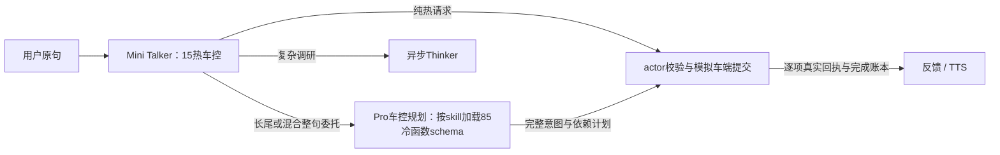

# 下一代车载语音助手：Talker-Thinker 双层架构设计

Oct 10, 2026 · @Michell Herty

> 2026-10-14 原型实施修订：用户确认采用15个常驻车控＋85个Pro渐进式车控。下文专用语法、SFT、约束解码和边缘fallback仍为目标设计，当前未实现这些能力，不能视为已部署。

当前实现的Talker为Mini，固定15个热车控和`delegate_vehicle_control/delegate_task/manage_task`；另有3个地点/天气函数。长尾或冷热混合请求由actor把未经改写的整句、实际车况、历史和已完成回执交给独立Pro车控规划层（thinking disabled）。Pro仅调用`load_skill/submit_vehicle_plan`，按子系统把实际函数schema渐进加入计划actions，冷schema不扩展到Talker。actor整组预检、按依赖串行执行，并以真实模拟状态提交回执核销意图；保持、失败、打断和迟到回执分别记录。复杂研究Thinker仍异步运行，研究建议确认与已授权车控执行分开。



此实现缩小前台可调用集合并增加执行账本，尚未证明任意自然语言多意图覆盖正确，也不承诺新增Pro后达到2秒。真实验收、历史失败和测量范围见[当前验收文档](docs/VALIDATION.md)。本次也修正原例1：不支持按摩时不得未经授权改开加热，不得在实际回执前声称完成。

## 1. 概述

本方案把车载语音助手拆成两层：一个永远在线、毫秒级响应的 **Talker**，和一个异步执行复杂任务的 **Thinker**。目标是达到 GPT Live 级别的自然度（说完到听到第一个字 400–600ms、随时可打断），同时能完成订座、整理发送邮件、行程规划等长达数分钟的任务。

### 1.1 设计原则

1. **对话不阻塞在思考上。** Talker 永远在线、永远可打断。Thinker 的任务全部异步执行，结果以事件形式回流，由 Talker 决定何时、如何说出来。
2. **共享会话状态，而非层间传话。** 两层读写同一份 Session State（对话记录、车辆状态、活跃任务、用户记忆），避免上下文在传递中丢失。
3. **人设只改变说法，永远不改变动作。** 车型决定"能做什么"，人设决定"怎么说"，两者彻底解耦。
4. **车端是最终执行权威。** 车控由云端下发，车端做安全校验后才执行；弱网时由车端兜底。
5. **语音保持克制。** 默认静默，屏幕承担进度展示；只在有信息量、且时机合适时开口。

### 1.2 三条执行路径

| 路径 | 典型需求 | 耗时 | 执行者 |
| --- | --- | --- | --- |
| 直接回答 | 闲聊、常识问答、单条车控 | < 1s | Talker 自身 |
| 同步工具调用 | 查天气、搜充电桩、放音乐、设导航 | 1–3s | Talker 调用工具后接着说 |
| 异步委托 | 订座、发邮件、行程规划、多步调研 | 10s – 数分钟 | Talker 委托给 Thinker，结果异步回流 |

中间这条"同步工具调用"路径很重要：大量中等需求只需一次工具调用，若都升级给 Agent，会无谓地拖慢体验。

## 2. 核心概念

理解本方案只需要掌握下面十个概念。其中最关键的转变是：从"一次请求、一次完整执行、一次返回"的同步模型，转向"提交任务、立即返回、结果以事件形式到达"的异步模型。

| 概念 | 含义 | 类比 |
| --- | --- | --- |
| Talker | 第一层。低延迟模型，负责听、说、打断、简单回答、委托与转述 | 前台接待 |
| Thinker | 第二层。推理模型 + agent harness，负责多步规划和工具调用 | 后台办事员 |
| 同步调用 | 调用方等待被调用方完成才继续，期间什么也做不了 | 打电话等对方查完 |
| 异步调用 | 调用方提交后立即拿到一个凭证（task\_id）就继续做别的，结果稍后通知 | 寄快递拿单号 |
| 任务（Task） | 一次委托的持久化记录：目标、状态、进度、结果，有唯一 task\_id | 快递单 |
| 事件（Event） | 某件事发生了的不可变通知，例如"任务需要澄清""任务完成" | 快递状态推送 |
| 事件总线（Event Bus） | 事件的传递通道，生产者发出、消费者订阅，两边互不直接调用 | 邮局 |
| 共享状态（Session State） | 两层共同读写的会话数据：对话、车况、活跃任务、进度摘要 | 共享白板 |
| Orchestrator | 每个会话的调度中枢：接收用户输入和任务事件，决定何时触发 Talker 生成 | 值班经理 |
| Speaking Arbiter | Orchestrator 内的策略模块，判断当前是否适合主动开口 | 判断"现在方便插话吗" |

### 2.1 同步与异步的直观对比

同步（现有纯 ReAct 系统）：用户说"帮我订座"，agent 循环执行搜索、查空位、下单，全程 30 秒，用户这 30 秒里只能等，期间说任何话都无法被处理。

异步（本方案）：用户说"帮我订座"，Talker 在 0.5 秒内回答"好，我去订"，同时创建任务；Thinker 在后台执行；用户可以继续聊天、调空调；任务遇到需要澄清或完成时发出事件，Talker 择机说出来。

### 2.2 为什么不能只靠"把 ReAct 放到后台线程"

把 agent 循环丢进后台线程只解决了"不阻塞"，还缺四样东西：

- **双向通信**：后台任务需要中途向用户提问，用户也需要中途修改或取消任务。
- **持久化**：任务可能跨越熄火、断网、服务重启，进程内的线程做不到。
- **说话时机**：结果到达时用户可能在打电话、在复杂路口，需要有人决定何时说。
- **可查询的进度**：用户问"怎么样了"时，要能立即回答，而不是去打断 agent。

第 7、8 节逐一讲解这四样东西如何实现。

## 3. 云侧整体架构

云侧由一个有状态的实时会话层、一个异步任务层和若干共享服务组成；两层之间只通过任务接口和事件总线通信，不直接互相调用。

&#91;embedded content: 云侧架构 · 实时会话层、异步任务层与共享服务\]

高亮的 Orchestrator 是会话的调度中枢：用户语音和回流的任务事件都汇入它。Talker 只通过 delegate\_task 进入 Task Service，Thinker 的事件经 Event Bus 回流，两层从不直接调用。

### 3.1 组件职责

| 组件 | 职责 | 关键技术点 |
| --- | --- | --- |
| Edge Gateway | 区域就近接入，终结 QUIC/WebSocket 连接，鉴权，会话亲和路由 | 车辆证书 mTLS + 用户 token |
| Realtime Session Service | 每辆车一个有状态 actor，持有音频流、对话上下文、播放进度；内含 Orchestrator 与 Arbiter | 绑定固定推理节点复用 KV cache |
| 语义端点检测 | 判断用户是否真的说完，避免在"嗯……那个……"处抢话 | 小模型，与 VAD 结合 |
| 流式 ASR | 语音转文本，输出 n-best 与置信度 | 边说边出结果 |
| Talker 推理集群 | 低延迟 LLM，输出内联标签流 | 约束解码、prefix cache、多 LoRA |
| 流式 TTS | 按句子块合成，支持人设音色和韵律标签 | 首包 < 100ms |
| 同步工具层 | 天气、POI、充电、媒体、导航、车控下发 | 调用 < 2s，超时触发提示音 |
| 工具检索 | 从中频工具库召回 3–5 个工具注入 Talker | embedding + 意图分类，约 25ms |
| Task Service | 任务注册表、状态机、任务 API（创建/回复/修改/取消/查询） | 持久化存储 |
| 工作流引擎 | 持久化执行 Thinker 的每一步，崩溃后从 checkpoint 恢复 | Temporal 类 durable execution |
| Agent Runtime（Thinker） | 推理模型 + harness，工具检索、规划、执行 | 工具通过 MCP 接入 |
| 凭证保险箱 | 存放第三方 OAuth token，绝不下发车机 | 按用户隔离 |
| Event Bus | 任务事件的发布与订阅 | Kafka / Pulsar / Redis Streams |
| Session State Store | 会话共享状态 | Redis |
| 能力注册表 | 车型 → 配置 → OTA → 地区 → 功能集合；编译并缓存约束解码语法 | 按 manifest\_id 缓存 |
| 用户记忆与画像 | 偏好、常去地点、家庭成员等 | 跨人设共享 |
| 推送服务 | 车机离线时把结果推到手机 App 或下次点火时补发 | 对接 TSP |
| 安全与审计 | 内容安全过滤、敏感操作审计、数据境内存储 | Talker 输出前、Agent 工具调用前两处过滤 |
| 观测与评测 | 全链路 trace、延迟分解、录音回放 | 离线 replay 测试集 |

### 3.2 一次请求流经的路径

1. 车端上行音频 → Gateway → Session actor。
2. 流式 ASR 与语义端点检测并行运行；端点确认后，Orchestrator 组装 prompt 触发 Talker。
3. Talker 的输出流被解析器实时拆分：文本送 TTS，车控送车端，工具调用送工具层，委托送 Task Service。
4. Task Service 创建任务，工作流引擎驱动 Thinker 执行；Thinker 产生的事件写入 Event Bus。
5. Session actor 订阅本会话的任务事件，写入 Session State，由 Arbiter 决定是否触发一轮由事件驱动的 Talker 生成。

## 4. Talker 输出格式：内联标签

Talker（级联方案中的 LLM）输出的不是纯文本，而是一条"语音文本 + 内联标签"的混合流：标签外的文本送 TTS 念出来，标签内的内容是动作或控制，由解析器拦截执行，永远不会被念出来。

```
<r:car/>好，开了点窗。<car obj="window" pos="fl" attr="open" act="set" val="30"/>来首轻松的。<call fn="media.play" query="轻松"/><listen mode="idle"/>
```

### 4.1 这不是新机制

所有 function calling 在 token 层面都是内联标签。例如 Qwen 系列模型实际生成的是 `<tool_call>{…}</tool_call>` 这样的文本，推理框架把它解析成 API 里的 `tool_calls` 字段。本方案只是不再依赖框架的封装，自己定义和解析这一层。先例包括 SSML（文本中插入停顿、语速标签）、Toolformer（句子中间插入 API 调用）、ReAct 的文本标记、推理模型的 `<think>` 标签。

### 4.2 为什么语音场景要自己做这一层

| 标准 function calling 的假设 | 语音场景的需求 |
| --- | --- |
| 一轮 = 一段文本 + 末尾若干 tool call | 需要交错：先说一句，执行车控，再说一句，更新屏幕 |
| tool call 完整解析后才返回 | 车控一生成完就要立刻下发 |
| 只有文本和工具两种输出 | 还有韵律、轮次、屏幕、不回应等通道 |
| 流式时常缓冲 tool call | 任何缓冲都直接变成延迟 |

### 4.3 标签语法

- **自闭合标签** `<名称 属性="值" … />`：用于只有参数、没有内容的动作，例如车控、工具调用、轮次控制。`<x/>` 等价于 `<x></x>`。
- **成对标签** `<名称>内容</名称>`：用于有内容但不念出来的通道，例如 `<screen>只显示的文字</screen>`、`<think>内部推理</think>`。
- **语音文本不包裹**：语音是默认通道，占输出 80% 以上；只标记例外，可减少 token、降低首字延迟、简化解析。

### 4.4 标签集

| 类别 | 标签 | 说明 |
| --- | --- | --- |
| 路由 | `<r:chat/>` `<r:tool/>` `<r:delegate/>` `<r:car/>` `<r:noop/>` | 第一个 token 给出决策，便于预热下游与评测 |
| 同步工具 | `<call fn="weather" city="深圳"/>` | 结果回填后进入下一段生成 |
| 委托 | `<call fn="delegate_task" domain="dining" goal="…"/>` | 立即返回 task\_id |
| 任务交互 | `<task_reply/>` `<task_update/>` `<task_cancel/>` | 回答澄清、修改、取消 |
| 车控 | `<car obj="…" pos="…" attr="…" act="…" val="…"/>` | 统一本体，见第 5 节 |
| 屏幕 | `<card type="…" ref="…"/>` `<screen>…</screen>` | 嘴上说简短版，屏幕显示详细版 |
| 韵律 | `<emo v="warm"/>` `<pause ms="300"/>` `<laugh/>` | 与 TTS 能力联合设计 |
| 轮次 | `<listen mode="expect"/>` `<listen mode="idle"/>` `<end/>` | expect：刚提问，保持麦克风并缩短端点等待 |

### 4.5 语音文本规范

- 口语化：不用 markdown、列表、括号注释；三项以上信息只说前一两项，其余放屏幕。
- 首句要短（≤ 10 字），让 TTS 首包尽早出来。
- 数字默认交给 TTS 文本正则化，有歧义处由模型写成口语形式。
- 不念 ID、URL，地址只说到地标级别。
- "我查一下"这类过渡语不由模型生成，由 Orchestrator 在工具超过约 400–600ms 未返回时插入提示音。

### 4.6 工程要点

1. **标签起始用特殊 token**（如 `<|car|>`）：用户输入、ASR 文本、邮件正文经过 tokenizer 永远产生不了这些 token，从根本上杜绝提示词注入。
2. **约束解码**（xgrammar、llguidance 等，vLLM 已集成）：标签外只允许自然语言字符；标签内的函数名和参数按 schema 枚举，模型不可能生成格式错误或不存在的指令。
3. **流式解析器**：按字符流切分，遇到标签起始符就缓冲，标签闭合立即分发；文本遇到句末标点就 flush 给 TTS。

```python
buf, in_tag = "", False
for ch in token_stream:
    if not in_tag and ch == "<":
        flush_speech(buf); buf, in_tag = "", True
    elif in_tag and ch == ">":
        dispatch(parse_tag(buf)); buf, in_tag = "", False
    else:
        buf += ch
        if not in_tag and ch in "。！？，" and len(buf) > 4:
            flush_speech(buf); buf = ""
```

4. **必须 SFT**：通用模型不认识自定义标签，可用强模型按格式合成多轮数据（含事件注入和打断）后微调。

## 5. 工具与车控分层

几百个车控功能和第三方 API 不能全放进 Talker 的 prompt：按每个 schema 约 100 token 计，300 个就是 3 万 token，会拉高每 token 生成时间并降低选择准确率。解决办法是按性质分三层，让 Talker 的 prompt 维持在几千 token 以内。

| 层级 | 内容 | 规模 | 处理方式 |
| --- | --- | --- | --- |
| A. 车控 | 车窗、空调、座椅、灯光、驾驶模式 | 几百个，封闭、稳定、高频 | 学进权重 + 统一本体 + 按车型约束解码 |
| B. 高频生态 | 导航、音乐、电话、天气、POI | 10–30 个 | 常驻 prompt 固定前缀 |
| B'. 中频同步 | 充电桩状态、停车场余位 | 数十个 | 每轮动态检索 3–5 个注入 prompt 末尾 |
| C. 长尾生态 | 订座、外卖、邮件、缴费等第三方 API | 几百个，开放多变 | 委托给 Thinker，由 Thinker 检索工具 |

### 5.1 车控本体：按对象-属性-动作组织

不设计 300 个函数名，而用一个统一结构：

```
<car obj="window" pos="fl" attr="open" act="set" val="30"/>
<car obj="seat" pos="driver" attr="heat" act="set" val="2"/>
<car obj="ac" attr="temp" act="adjust" val="-2"/>
```

几百个功能被压缩成几十个对象、十几种属性、几个动作的组合。模型学的是组合规律，OTA 新增的同结构功能往往能直接泛化。下次训练之前，可把新功能的一句话描述临时放进 prompt 过渡。

### 5.2 能力管理：三种限制，三种处理

| 层次 | 例子 | 处理方式 |
| --- | --- | --- |
| 静态能力 | 没有座椅按摩、没有后排屏 | 编进约束解码语法，模型生成不出该指令 |
| 权益 | 未订阅高阶功能、儿童锁 | 允许生成，由云端或车端拒绝并返回原因码 |
| 动态可用性 | 行驶中禁播视频、车速过快禁开天窗 | 车端校验后拒绝并返回原因码 |

- 车端建会话时只上报 `manifest_id`，云端从能力注册表解析功能集合，并缓存编译好的语法。
- 拒绝必须返回结构化原因码（`not_subscribed`、`blocked_while_driving`、`child_lock`）及恢复条件，Talker 用当前人设的语气解释。"做不了"和"现在不能做"是两种不同的回答。
- 本体中把可能被动态拒绝的动作标记为 `may_reject_dynamic`，模型被训练成对这类动作先执行、拿到回执后再表态（见第 13 节例 6）。
- 用户手册问答按车型 + OTA 版本分别建索引检索。

### 5.3 端侧兜底

车控大多同时由端侧 ASR + NLU 并行识别、本地直接执行，弱网和隧道场景不受影响。云端 Talker 主要负责组合指令，例如"有点冷，把我这边弄暖和点"同时映射到空调和座椅加热。

### 5.4 动态检索的注意点

- 检索与语义端点检测并行，不增加关键路径延迟。
- 检索到的 schema 追加在 prompt 末尾，不插在前面，以免破坏 prefix cache。
- 约束解码语法同步加入这几个函数。

## 6. 多车型、子品牌与人设

一个 Talker 基座模型服务所有车型、品牌和人设组合；差异全部通过配置注入：能力决定约束解码语法，品牌和人设决定 prompt 层，人设同时决定 TTS 音色。

| 维度 | 决定什么 | 变化频率 | 组合数 |
| --- | --- | --- | --- |
| 能力（车型 × 配置 × OTA × 地区 × 订阅） | 能执行哪些动作 | 随 OTA 和订阅变化 | 数百到上千 |
| 品牌（子品牌） | 唤醒词、可选人设、语气底线、品牌知识、合规话术 | 很慢 | 个位数 |
| 人设 | 身份、故事、说话风格、音色 | 中等，可随时切换 | 每品牌几到十几个 |

### 6.1 Prompt 分层与缓存

按"变化越慢越靠前"排列，最大化 prefix cache 命中：

1. L0 全局层：输出格式规则、标签语法、车控本体摘要、安全底线（所有请求共享）。
2. L1 品牌层：品牌语气底线、品牌知识、合规话术。
3. L2 人设层：人设卡片（品牌 × 人设只有几十种，可全部常驻缓存）。
4. L3 能力摘要：这台车的特殊或缺失功能简表，几十到一两百 token；能力主要靠语法约束。
5. L4 会话层：用户记忆、车辆状态、活跃任务及其进度摘要。
6. 对话历史、当前输入、动态检索到的工具。

### 6.2 人设的实现

| 方式 | 优点 | 缺点 |
| --- | --- | --- |
| 人设卡片放 prompt | 新增零训练成本，运营可配置 | 风格还原度有上限，长对话可能出戏 |
| 每个人设一个 LoRA | 风格还原度高 | 需训练；可能损伤工具调用能力 |

建议：基座做一次"能根据人设卡片切换风格"的 SFT（同一场景多个人设的回复），大部分人设只用卡片；少数旗舰人设再加 LoRA，用 vLLM 多 LoRA serving 部署。LoRA 只用风格数据训练，每次上线前跑工具调用回归测试。

人设卡片示例：

```
[persona]
id: xiaoyu
身份: 车载伙伴，25岁设定，前电台主持人
性格: 温暖、俏皮、偶尔自嘲，不油腻
说话风格: 短句多，爱用"嘛""呀"，偶尔玩谐音梗
口头禅: "稳稳的~"（每十轮最多一次）
故事要点: 喜欢夜间电台、老歌、海边公路（详细设定见 lore 库）
情绪范围: 开心/关切/安慰；不表现愤怒和冷漠
禁区: 不评价外貌和隐私，不谈政治，不假装是人类
音色: tts_voice=xiaoyu_v3, 默认语速 1.05
```

- 口头禅必须限频，否则显得机械。
- 完整人设故事放 lore 库，被问到时检索，不全部塞进 prompt，避免前后矛盾。

### 6.3 人设强度随场景调节

| 场景 | 强度 | 表现 |
| --- | --- | --- |
| 闲聊、陪伴 | 满 | 完整风格、口头禅、故事 |
| 普通信息、车控反馈 | 中 | 保留语气，内容简洁 |
| 确认（支付、发送、订单） | 低 | 清晰第一，只保留音色和基本语气 |
| 安全提醒、故障告警 | 零 | 统一标准话术，建议用固定模板或录音 |

Orchestrator 每轮注入 `[persona_intensity=…]`，训练数据覆盖各强度。

### 6.4 人设与 Thinker 的关系

- Thinker 不知道人设存在，只输出中性的结构化结果和 `spoken_hint`，由 Talker 用当前人设重新表达。切换人设不影响进行中的任务。
- Thinker 替用户写的内容（邮件、消息）用用户的口吻，绝不带人设风格。
- 用户记忆跨人设共享；人设与用户之间的"关系记忆"是否独立，属于产品决策。

## 7. 异步实现（上）：从纯 ReAct 到异步的核心思想

异步化不需要推翻现有的 ReAct agent，ReAct 循环本身可以原样保留；需要改变的是它的"外壳"：谁启动它、它如何暂停和恢复、它如何与外界通信。本节讲思想，第 8 节讲具体实现。

### 7.1 现状：同步 ReAct 的结构

```python
def handle_request(user_text):
    messages = [system_prompt, user_text]
    while True:
        resp = llm(messages, tools)
        if resp.tool_call is None:
            return resp.text                 # 整个循环结束才返回
        if resp.tool_call.name == "ask_user":
            answer = wait_for_user_reply()   # 阻塞！整个进程卡在这里
            messages.append(answer)
            continue
        result = run_tool(resp.tool_call)
        messages.append(result)
```

这个结构有四个问题：

1. **调用方被阻塞**：`handle_request` 在整个循环结束前不返回，用户这段时间说的话无人处理。
2. **向用户提问会卡住进程**：`wait_for_user_reply()` 让一个进程空等，可能等几分钟。
3. **状态只在内存里**：进程崩溃、服务发版、车辆断网，`messages` 就丢了，任务只能从头开始。
4. **外界无法介入**：用户想加条件、取消、问进度，都没有入口。

### 7.2 五个转变

**转变一：提交与执行分离。** 收到委托后，不直接运行循环，而是先写一条任务记录，立刻返回 `task_id`。真正的执行由后台 worker 拉起。调用方（Talker）几十毫秒就拿到结果，继续说话。这就是"寄快递拿单号"。

**转变二：循环变成可暂停、可恢复的状态机。** ReAct 的每一次"思考 + 工具调用"是一个**步骤（step）**。每个步骤结束都把 `messages` 和状态写入持久化存储（checkpoint）。需要用户回答时，不再阻塞等待，而是把状态设为 `awaiting_input`、发出一个事件，然后**本次执行直接结束**，worker 被释放去干别的事。等用户的回答到达，系统用这份 checkpoint 重新拉起循环，从断点继续。

关键心智模型：在同步 ReAct 里，`ask_user` 是一个**阻塞的工具**；在异步 ReAct 里，`ask_user` 是一个**让循环挂起的工具**。

**转变三：用事件和收件箱通信。** 两个方向各一个通道：

- 出站：Thinker 把"需要澄清""进度更新""完成"写成事件，发到事件总线，谁关心谁订阅。Thinker 不知道也不关心谁会收到。
- 入站：用户的回答、补充条件、取消请求，写进该任务的**收件箱（inbox）**。Thinker 在每个步骤的边界检查收件箱，而不是在一次工具调用的中途被打断。

**转变四：进度写进共享状态。** 每到一个里程碑，Thinker 写一段人能看懂的 `status_summary` 到共享状态。用户问"怎么样了"，Talker 直接读这段文字回答，不需要打扰 Thinker。

**转变五：Talker 侧变成事件驱动。** 过去只有"用户说话"才会触发生成。现在 Session actor 同时监听四种输入：用户语音、任务事件、车辆状态变化、定时器。任何一种都可能触发一轮 Talker 生成，由 Arbiter 决定此刻是否合适开口。

### 7.3 两种"异步"不要混淆

| 层面 | 解决什么 | 典型工具 | 用在哪 |
| --- | --- | --- | --- |
| 进程内并发 | 一个进程同时处理多路流：收音频、发音频、等工具、等事件 | Python asyncio、Go goroutine | Session actor、Talker 流式管线 |
| 跨进程的异步任务 | 任务脱离请求独立运行，可暂停恢复，扛得住崩溃 | 任务表 + 消息队列 + worker；或 Temporal | Task Service + Thinker |

团队容易以为"用了 asyncio 就是异步了"。asyncio 只解决第一层；任务一旦跨越分钟级、跨越重启和断网，就必须有第二层。

### 7.4 分布式异步的四条铁律

1. **消息至少送达一次，可能重复**：网络重试会导致同一事件或同一工具调用出现两次。每个事件带 `event_id`，消费方去重；每个有副作用的工具调用（下单、发邮件）带幂等键 `idem_key`，第三方或我们的工具网关据此去重。
2. **顺序靠序号保证**：同一任务、同一会话的事件带递增 `seq`；事件总线按 `session_id` 分区，保证同一会话内有序。
3. **状态和事件要原子写入**："把任务状态改成 awaiting\_input"和"发出 needs\_input 事件"必须同时成功或同时失败，否则会出现状态改了但用户永远收不到提问的情况。标准做法是 outbox 模式（见 8.4）。
4. **一切都可能超时**：等用户回答、等第三方回复、等工具返回，都要有超时和过期处理，不能无限挂起。

### 7.5 持久化执行（Durable Execution）是什么

Temporal 这类引擎把上面的模式做成了框架。它的核心思想是：

- 你把整个任务写成一个普通函数（workflow），里面可以有循环、`await` 工具调用、`await` 等待用户回复的信号、`sleep` 一小时。
- 每个有副作用的操作（LLM 调用、工具调用）被包装成 activity，引擎记录它的输入和结果。
- 进程崩溃后，引擎在另一台机器上重新执行这个函数；遇到已经记录过的 activity，直接返回记录的结果而不重新调用（这叫 replay），于是函数"快进"到崩溃前的位置继续执行。
- "等待用户回复"在引擎里不占任何进程，只是一条持久化的等待记录；回复以 signal 的形式到达后，函数被唤醒。

效果是：**写代码时像写同步 ReAct 一样自然，运行时却具备暂停、恢复、容错的能力。** 代价是要遵守它的规则（workflow 函数必须确定性，不能直接读时间、随机数、做 IO）。

## 8. 异步实现（下）：组件与代码骨架

落地需要六个部件：任务表、状态机、事件格式、outbox、改造后的 Thinker 循环、Talker 侧的 Session actor。下面给出每个部件的结构和可直接参考的代码骨架，最后给出两种技术选型。

### 8.1 数据模型

```sql
-- 任务主表：一行一个任务，也是 checkpoint 的载体
CREATE TABLE tasks (
  task_id        TEXT PRIMARY KEY,
  session_id     TEXT NOT NULL,
  user_id        TEXT NOT NULL,
  short_name     TEXT,            -- 口语名："订座" "给老王的邮件"
  goal           TEXT NOT NULL,
  state          TEXT NOT NULL,   -- 见 8.2
  step           INT  DEFAULT 0,
  messages       JSONB,           -- ReAct 上下文，每步后覆盖写入
  pending_call   JSONB,           -- 等待确认的不可逆调用
  status_summary TEXT,            -- 给人看的进度摘要
  progress       REAL,
  eta_s          INT,
  budget_s       INT,             -- 软预算
  deadline       TIMESTAMPTZ,     -- 硬上限
  version        INT  DEFAULT 0,  -- 乐观锁
  updated_at     TIMESTAMPTZ
);

-- 收件箱：用户发给任务的消息，Thinker 在步骤边界读取
CREATE TABLE task_inbox (
  id BIGSERIAL PRIMARY KEY, task_id TEXT, kind TEXT,  -- reply | update | cancel | confirm | timeout
  payload JSONB, consumed BOOLEAN DEFAULT FALSE, created_at TIMESTAMPTZ
);

-- 出站事件：与状态变更在同一事务写入（outbox 模式）
CREATE TABLE outbox (
  event_id TEXT PRIMARY KEY, task_id TEXT, session_id TEXT, seq INT,
  type TEXT, payload JSONB, published BOOLEAN DEFAULT FALSE, created_at TIMESTAMPTZ
);
```

### 8.2 任务状态机

&#91;embedded content: 任务状态机 · 8 个状态\]

running 是唯一占用 worker 的状态；进入任一 awaiting 状态时本次执行结束，由用户回复或定时器重新拉起。

| 状态 | 含义 | 离开条件 |
| --- | --- | --- |
| created | 已登记，尚未执行 | worker 拉起 → planning |
| planning | 第一步：规划并给出 ETA 与里程碑 | 发出 task.plan → running |
| running | 正常执行 ReAct 步骤 | 调用 ask\_user → awaiting\_input；遇到不可逆动作 → awaiting\_confirm；完成 → done；出错 → failed；收到取消 → cancelled |
| awaiting\_input | 挂起，等用户澄清，不占 worker | 收到 reply 或超时 → running |
| awaiting\_confirm | 挂起，等用户确认不可逆动作 | 确认 → running（执行 pending\_call）；拒绝 → running（告知 agent 被拒）；超时 → running 或 failed |
| done / failed / cancelled | 终态 | — |

### 8.3 事件格式

```json
{
  "event_id": "ev_7f3a…",          // 全局唯一，消费方据此去重
  "task_id": "t3",
  "session_id": "s_abc",
  "seq": 5,                         // 同一任务内递增
  "type": "task.needs_input",
  "priority": "P1",
  "created_at": "2026-10-10T18:02:11Z",
  "expires_at": "2026-10-10T18:20:00Z",
  "payload": {
    "question": "19:00无位，可选19:30或20:00",
    "options": ["19:30", "20:00"],
    "spoken_hint": "七点没位，七点半或八点有位"
  }
}
```

事件总线按 `session_id` 分区（同一会话的事件进同一分区，保证有序），Session actor 订阅自己会话的分区；推送服务同时订阅，用于车机离线时转发到手机。

### 8.4 Outbox 模式：状态与事件原子写入

问题：如果先更新任务状态、再向消息队列发事件，中间进程崩溃，就会出现"任务在等用户回答，用户却永远收不到问题"。

做法：状态更新和事件写入**同一个数据库事务**（写进 outbox 表），再由一个独立的转发器把 outbox 中未发布的事件发到事件总线、标记为已发布。转发器可能重复发送，所以消费方必须按 `event_id` 去重。

```python
def suspend(task, new_state, event):
    with db.transaction() as tx:
        tx.update_task(task.id, state=new_state, messages=task.messages,
                       pending_call=task.pending_call, expected_version=task.version)
        tx.insert_outbox(event)                 # 同一事务
        tx.schedule_timer(task.id, at=event["expires_at"], kind="timeout")
    # 事务提交后，本次执行结束，worker 被释放

# 独立的转发器进程
def outbox_relay():
    while True:
        for ev in db.fetch_unpublished(limit=100):
            bus.publish(topic=f"session.{ev.session_id}", key=ev.session_id, value=ev)
            db.mark_published(ev.event_id)
        sleep(0.05)
```

### 8.5 Task API（供 Talker 调用）

| 接口 | 作用 | 实现要点 |
| --- | --- | --- |
| create(goal, context\_ref, constraints) | 创建任务，立即返回 task\_id 与 short\_name | 写 tasks 表，投递首个 run\_step 作业，< 50ms |
| reply(task\_id, answer) | 回答澄清 | 写 inbox；若状态为 awaiting\_input，改为 running 并投递 run\_step |
| confirm(task\_id, step\_id, token, decision) | 确认或拒绝不可逆动作 | 校验 token 与 pending\_call 的内容哈希一致，不一致则拒绝 |
| update(task\_id, change) | 追加或修改条件 | 写 inbox；运行中的任务在下一步边界读取 |
| cancel(task\_id) | 取消 | 写 inbox；挂起中的任务直接进终态 |
| get(task\_id) | 查询状态与进度摘要 | 读 Session State 缓存即可，不打扰 Thinker |

### 8.6 Thinker 循环改造：方案 A（自研，一步一作业）

思路：把 ReAct 循环拆成"一次只跑一步"的作业。每跑完一步就 checkpoint，然后把下一步重新投入队列；需要等待时，不再投递，任务自然挂起。任何时刻崩溃，最多损失一步。

```python
TERMINAL = {"done", "failed", "cancelled"}
IRREVERSIBLE = {"platform_a.book", "email.send", "payment.pay"}

def run_step(task_id):                          # worker 从队列取到作业时执行
    task = store.load_and_lock(task_id)         # SELECT … FOR UPDATE，防止两个 worker 同跑一个任务
    if task.state in TERMINAL or task.state.startswith("awaiting"):
        return

    # 1) 步骤边界：先处理收件箱
    for msg in store.drain_inbox(task_id):
        if msg.kind == "cancel":
            return finish(task, "cancelled")
        if msg.kind == "confirm":
            if msg.payload["decision"] == "yes":
                result = tools.run(task.pending_call, idem_key=f"{task.id}:{task.pending_call['id']}")
                task.messages.append(tool_result(result))
            else:
                task.messages.append(tool_result({"error": "user_declined"}))
            task.pending_call = None
        else:                                   # reply / update / timeout 都作为新信息进入上下文
            task.messages.append(user_note(msg))

    # 2) 一次 ReAct 迭代（原有逻辑基本不变）
    resp = llm(task.messages, tools=THINKER_TOOLS)
    task.messages.append(resp)
    call = resp.tool_call

    if call is None:                            # agent 认为完成
        return finish(task, "done", result=resp.final)

    if call.name == "ask_user":                 # 挂起，不再阻塞
        return suspend(task, "awaiting_input", needs_input_event(task, call))

    if call.name in IRREVERSIBLE:               # 不可逆动作先要确认
        task.pending_call = call
        return suspend(task, "awaiting_confirm", needs_confirm_event(task, call))

    if call.name == "report_progress":          # agent 自报里程碑
        store.set_summary(task, call.args["summary"], call.args["progress"])
        emit(task, "task.milestone", call.args)
        result = {"ok": True}
    else:
        result = tools.run(call, idem_key=f"{task.id}:{task.step}")

    task.messages.append(tool_result(result))
    task.step += 1
    if over_soft_budget(task):
        return suspend(task, "awaiting_input", budget_exceeded_event(task))
    store.checkpoint(task)                      # 写回 messages、step、version+1
    queue.enqueue(run_step, task_id)            # 下一步重新入队
```

要点：

- 给 Thinker 增加三个"元工具"：`ask_user(question, options, expires_in)`、`report_progress(summary, progress)`、`plan(eta_s, milestones)`。现有业务工具不用改。
- 定时器到期时，向收件箱写一条 `timeout` 消息并投递 run\_step，由 agent 自己决定是用默认选项继续还是放弃。
- `idem_key` 用 `task_id + step` 生成：即使同一步因重试被执行两次，下单、发邮件也只会生效一次。

### 8.7 Thinker 循环改造：方案 B（Temporal）

同样的逻辑用 Temporal 写，读起来几乎和同步 ReAct 一样；暂停、恢复、重试、定时器都由引擎负责。

```python
from datetime import timedelta
import asyncio
from temporalio import workflow

@workflow.defn
class AgentTask:
    def __init__(self):
        self.inbox, self.cancelled, self.summary = [], False, ""

    @workflow.signal                      # 用户回答 / 补充条件 / 确认，都以 signal 送入
    def user_message(self, msg: dict): self.inbox.append(msg)

    @workflow.signal
    def cancel(self): self.cancelled = True

    @workflow.query                       # 外部随时可查，不打断执行
    def status(self) -> str: return self.summary

    @workflow.run
    async def run(self, goal: str, ctx: dict):
        messages = build_messages(goal, ctx)
        step = 0
        while True:
            if self.cancelled:
                return await self.finish("cancelled")
            messages += drain(self.inbox)

            resp = await workflow.execute_activity(
                call_llm, messages, start_to_close_timeout=timedelta(seconds=90))
            messages.append(resp)
            call = resp.get("tool_call")
            if call is None:
                return await self.finish("done", resp)

            if call["name"] == "ask_user":
                await workflow.execute_activity(emit_event, needs_input(call),
                                                start_to_close_timeout=timedelta(seconds=10))
                try:                      # 挂起：不占用任何进程，可以等几十分钟
                    await workflow.wait_condition(lambda: bool(self.inbox) or self.cancelled,
                                                  timeout=timedelta(minutes=20))
                except asyncio.TimeoutError:
                    messages.append(user_note({"kind": "timeout"}))
                continue

            result = await workflow.execute_activity(
                run_tool, call, f"{workflow.info().workflow_id}:{step}",   # 幂等键
                start_to_close_timeout=timedelta(seconds=60))
            messages.append(result)
            step += 1
```

- `call_llm`、`run_tool`、`emit_event` 都是 activity：引擎记录结果，崩溃恢复时 replay，不会重复调用。
- Task API 的 `reply/update/confirm` 对应发送 signal；`get` 可以读 Session State，也可以用 query。
- 消息历史很长时，建议只在 workflow 里保存引用（对象存储 key），避免 workflow 历史过大。

### 8.8 Talker 侧：事件驱动的 Session actor

每辆车一个 actor，所有输入统一进一个队列，由一个主循环串行处理，避免并发修改会话状态。正在进行的生成是一个可取消的 asyncio Task，打断时直接取消。

```python
class SessionActor:
    def __init__(self, sid):
        self.sid, self.inq = sid, asyncio.Queue()
        self.state = SessionState.load(sid)    # 对话、车况、活跃任务、进度摘要
        self.pending = PriorityQueue()          # 等待播报的任务事件（按优先级、截止时间排序）
        self.turn = None                        # 当前正在生成的轮次

    async def run(self):
        await asyncio.gather(self.read_device(), self.read_task_events(),
                             self.ticker(), self.main_loop())

    async def read_task_events(self):
        async for ev in bus.subscribe(f"session.{self.sid}"):
            if self.state.seen(ev.event_id):    # 去重
                continue
            self.state.apply_task_event(ev)     # 更新活跃任务表与 status_summary
            await self.inq.put(("task_event", ev))

    async def ticker(self):                     # 定期重新评估是否可以开口
        while True:
            await asyncio.sleep(0.5)
            await self.inq.put(("tick", None))

    async def main_loop(self):
        while True:
            kind, item = await self.inq.get()
            if kind == "user_utterance":
                await self.start_turn(user=item)
            elif kind == "barge_in":
                self.cancel_turn(played_text=item.played_text)   # 截断历史为实际播出的部分
            elif kind == "vehicle_state":
                self.state.vehicle = item
            elif kind == "task_event" and item.priority != "silent":
                self.pending.push(item)
            await self.maybe_speak()

    async def maybe_speak(self):
        if self.turn and not self.turn.done():  # 正在说话时不插入
            return
        ev = self.pending.peek()
        if ev and arbiter.can_speak(ev, self.state):
            self.pending.pop()
            await self.start_turn(event=ev)     # 由事件驱动的一轮生成
        elif ev and ev.expired():
            self.pending.pop()

    async def start_turn(self, user=None, event=None):
        prompt = build_prompt(self.state, user=user, event=event)
        self.turn = asyncio.create_task(stream_talker(prompt, self.dispatch))
```

`dispatch` 就是第 4 节的流式解析器出口：文本送 TTS，`<car>` 送车端，`<call fn="delegate_task">` 调用 Task API 的 create，`<task_reply>` 调用 reply。

### 8.9 资源与保护

- **并发上限**：按用户限制同时运行的任务数（例如 3 个），超出时 Talker 告知用户排队。
- **预算**：每个任务有软预算（超过则交付当前最佳结果并询问是否继续）和硬上限（必须结束）。
- **worker 隔离**：浏览器沙箱类工具单独一组 worker，避免慢工具占满所有 worker。
- **可观测**：每个任务一条 trace，串起 Talker 委托、每个步骤、每个事件、最终播报，便于回放排查。

### 8.10 技术选型

|  | 方案 A：自研 | 方案 B：Temporal |
| --- | --- | --- |
| 组成 | Postgres（任务表、inbox、outbox）+ Kafka/Redis Streams + 作业队列 + 定时器 | Temporal 集群 + 事件总线 |
| 优点 | 组件熟悉、可控、无新依赖 | 暂停恢复、重试、定时器、replay 开箱即用；代码像同步 ReAct |
| 缺点 | 锁、重试、定时器、outbox 都要自己写对 | 新组件学习成本；workflow 必须确定性 |
| 适合 | 快速原型、任务类型少 | 生产环境、长程任务多 |

建议：原型阶段用方案 A，两三周内跑通完整链路，团队借此吃透异步的概念；进入生产前评估迁移到方案 B。两种方案的 Task API 和事件格式完全相同，Talker 侧无需改动。

## 9. 两层协作协议

Talker 通过一个工具委托任务，Thinker 通过一组事件回报；Talker 永远先口头应答再等结果，Thinker 永远不直接对用户说话。

### 9.1 委托

```json
// Talker 输出 <call fn="delegate_task" …/> 后，解析器调用 Task API
delegate_task {
  "goal": "订今晚7点海底捞福田店4人位",
  "domain": "dining",
  "context_ref": "session:abc#turn42",   // 引用共享状态，而非复制全文
  "constraints": {"deadline": "18:30"},
  "speaker": "driver"                     // 声纹识别结果，决定用谁的账号
}
→ 立即返回 {"task_id": "t3", "short_name": "订座", "state": "created"}
```

### 9.2 事件类型

| 事件 | 含义 | 默认优先级 | Talker 行为 |
| --- | --- | --- | --- |
| task.plan | 预估时长与里程碑 | P3 | 预计超过 10 秒时告知用户大致等待时间 |
| task.milestone | 用户视角的阶段进展 | P3 | 默认只更新屏幕；用户问起时读 status\_summary 回答 |
| task.partial\_result | 阶段性可用结果 | P2 | 择机播报 |
| task.needs\_input | 需要澄清，带选项与过期时间 | P1 | 在自然停顿处询问 |
| task.needs\_confirm | 不可逆动作前确认，带 confirm\_token | P1 | 低人设强度朗读要点，屏幕显示详情，要求明确确认 |
| task.budget\_exceeded | 超过软预算 | P2 | 交付当前结果并询问是否继续 |
| task.result | 完成 | P2 | 择机播报 |
| task.failed | 失败 | P2 | 说明原因并给替代方案 |

上行（Talker → Task Service）：`reply`、`confirm`、`update`、`cancel`，对应标签 `<task_reply/>`、`<task_update/>`、`<task_cancel/>`。同时有多个任务在等输入时，Talker 先消歧（"你说的是订座还是邮件？"）。

### 9.3 确认的安全设计

- `confirm_token` 绑定 `task_id + step_id + 内容哈希`，内容一旦变化必须重新确认。
- 必须是明确的肯定表达；"嗯"这类 backchannel 不算确认，确认时关闭 backchannel 误触发。
- 长内容（邮件正文）行驶中只读摘要，详情停车后在屏幕查看。

### 9.4 Speaking Arbiter：何时主动开口

| 优先级 | 内容 | 策略 |
| --- | --- | --- |
| P0 | 安全、导航播报 | 永远优先，Talker 让路 |
| P1 | 带截止时间的确认或澄清 | 尽快在合适时机说；临近截止时升级 |
| P2 | 任务结果、阶段结果 | 合适时机说 |
| P3 | 普通进度 | 只发提示音和屏幕卡片 |

禁止开口的条件：用户正在说话；正在通话；导航即将进入复杂路口或匝道；高速变道中（读取导航与 ADAS 信号）；Talker 正在说上一句。

Arbiter 策略应做成可配置、可 A/B 测试：插话太多显得烦，太少用户会忘记任务。

## 10. 长任务处理

持续一两分钟甚至更久的任务，架构上已经异步，不会阻塞对话；难点在等待期间的体验：用户感受到的应该是"它在帮我办事，我可以继续做别的"，而不是"它卡住了"。

### 10.1 两类长任务

| 类型 | 例子 | 用户心理 | 策略 |
| --- | --- | --- | --- |
| 执行型 | 订座、整理并发送邮件、缴费 | "交给你了，办完告诉我" | 静默执行，完成后通知 |
| 回答型 | 周末自驾规划、对比两款保险 | "我在等答案" | 先给初步回答，再逐步完善 |

### 10.2 六条策略

1. **开始时设定预期**：Thinker 第一步规划，发出 `task.plan`（ETA + 里程碑）。Talker 只需区分量级：几秒说"稍等"，一两分钟说"大概要一两分钟，好了叫你"。
2. **默认静默，屏幕展示进度**：不逐步播报工具调用。只在用户主动询问、用户明显在等且已过 30–45 秒、或出现值得说的阶段结果时才开口，而且要说有信息量的话（"已经挑出三个地方了"），不说"还在处理中"。
3. **里程碑面向用户**：Thinker 内部二十次工具调用，对外只发几个用户能理解的里程碑，并同步更新 `status_summary`。
4. **支持中途修改**：用户补充"要能带狗的"，Talker 输出 `<task_update/>`，Thinker 在下一个步骤边界读取；若新条件让之前的工作失效，由 Thinker 决定从哪一步重做。不可逆步骤执行中的修改排到该步之后或回到确认环节。
5. **随时可交付**：回答型任务由 Talker 先用自身知识给粗略回答；Thinker 中途可发 `task.partial_result`；超过软预算交付当前最佳结果并询问是否继续，达到硬上限必须结束。
6. **会话可能已结束**：结果作为 P2 事件进入 Arbiter，择机主动播报（前置提示音）；通话中则只更新屏幕；熄火后推送手机并在下次上车时提一句；断网期间任务在云端继续，事件按序号补发。

### 10.3 时间线示例：两分钟的行程规划

| 时间 | 发生了什么 | Talker 输出 |
| --- | --- | --- |
| 0s | 用户："周末想自驾出去玩，帮我规划一下，别超过两小时车程" | 先给初步方向（惠州海边、东莞松山湖），同时委托 |
| 3s | task.plan 到达，ETA 90s | "大概要一分半钟，好了叫你。"并显示进度卡片 |
| 20s | 用户闲聊："今天路上怎么这么堵" | 正常回答，后台任务不受影响 |
| 35s | task.milestone：筛出 3 个候选 | Arbiter 判断用户未在等，只更新屏幕 |
| 50s | 用户："哦对了，要能带狗的" | `<task_update id="t7" add="宠物友好"/>`，Thinker 下一步重筛 |
| 70s | 用户："查得怎么样了？" | 直接读 status\_summary："还剩双月湾和较场尾两个能带狗的，正在看天气。" |
| 105s | task.result 到达，Arbiter 放行 | 推荐双月湾并询问"要现在帮你订民宿吗？"，引出新任务 |

对应的 Talker 关键输出：

```
0s:   <r:delegate/>好呀，我先帮你查查。一般两小时内的话，惠州海边和东莞松山湖都挺受欢迎的，我再结合天气和路况仔细排一下。<call fn="delegate_task" domain="travel_plan" goal="周末自驾游规划，车程≤2h，出发地深圳"/><listen mode="idle"/>
50s:  <task_update id="t7" add="宠物友好"/>好，加上能带狗的条件。<listen mode="idle"/>
105s: <r:chat/>周末规划好啦。推荐惠州双月湾，周六大晴天，开过去一小时四十分钟左右，有两家民宿可以带狗。详细行程放屏幕上了，要现在帮你订民宿吗？<card type="trip_plan" ref="t7"/><listen mode="expect"/>
```

## 11. 端云通信设计

整车维持一条点火即建立的多路复用长连接：主通道用 QUIC，UDP 不通时降级为 WebSocket over TLS；音频、控制、事件走各自独立的 stream。

### 11.1 传输层选择

| 方案 | 优点 | 缺点 |
| --- | --- | --- |
| QUIC（推荐） | 连接迁移，基站切换、进出隧道不断连；无队头阻塞；0-RTT 恢复 | 部分网络 UDP 受限 |
| WebSocket over TLS/TCP | 兼容性最好 | 弱网队头阻塞，切换基站需重连 |
| WebRTC | 音频栈成熟 | 车机已有 DSP 级 AEC 与波束成形，优势用不上，信令更重 |

Stream 划分：

- `audio_up`：上行音频，Opus 16kHz、20ms 帧、约 24kbps。
- `audio_down`：下行音频，Opus 24kHz，带序号和时间戳。
- `control`：会话控制、打断、车控指令，可靠、高优先级。
- `events`：任务事件、屏幕卡片，可靠。

### 11.2 端侧职责

- 唤醒词、AEC、波束成形、声源定位（区分主驾和副驾）、本地 VAD。
- **本地打断**：检测到用户开口时立即淡出 TTS（< 100ms），不等云端，同时上报 `input.speech_started`。
- **上报播放进度**：打断时报告实际播放到的文本或音频偏移，云端据此截断对话历史，否则模型会以为用户听到了没播出的内容。
- **本地兜底**：端侧 ASR + NLU 并行识别车控指令并本地执行；弱网、隧道、地库由端侧完成基础交互。
- **车控最终校验**：所有云端下发的车控在端侧做安全与可用性校验，拒绝时返回原因码。

### 11.3 消息协议

所有消息带 `session_id`、`seq`、`ts`，断线后按 seq 补发。

```
上行：
  session.open / session.resume(token, last_seq)
  input.audio / input.speech_started / input.speech_ended
  playback.progress(item_id, played_ms, played_text)
  vehicle.state(速度、档位、导航状态、ADAS 状态；变化时推送)
  vehicle.command_result(cmd_id, ok | rejected, reason, resume_condition)
  ui.action(屏幕上的确认、取消、选择)

下行：
  output.audio_chunk / output.transcript_delta / output.done
  output.cancel(item_id)                // 服务端确认打断
  vehicle.command(cmd_id, obj, attr, act, val)
  ui.card(task_id, type, payload)        // 任务进度、确认卡片
  task.event(...)                        // 见第 9 节
  earcon(type)                           // 提示音
```

### 11.4 会话生命周期与离线投递

1. 点火即预建连接，避免唤醒时再握手。
2. 唤醒后进入全双工对话窗口，持续上行音频；静默 N 秒后关闭麦克风上行，连接保持。
3. 断线后用 `session.resume(last_seq)` 恢复，服务端缓存最近 30 秒事件用于补发。
4. 熄火时完成的任务：结果存于 Task Service，同时推送手机 App；下次点火作为 P2 事件择机播报。

### 11.5 安全

- 车辆证书 mTLS + 用户身份 token；声纹决定调用哪个用户的账号。
- 第三方 OAuth 凭证只存云端保险箱，绝不下发车机。
- 数据境内存储，敏感操作全量审计；内容安全过滤放在 Talker 输出前和 Agent 工具调用前。

## 12. 延迟预算

目标是用户说完到听到第一个字 P50 约 400–600ms；打断响应 < 150ms，委托后的口头应答 < 700ms。

| 环节 | 目标 |
| --- | --- |
| 语义端点判定 | 150–250ms |
| 网络 RTT（4G/5G，区域就近接入） | 30–60ms |
| Talker 首 token | 100–200ms |
| TTS 首包（级联方案） | 50–100ms |
| 端侧 jitter buffer | 40ms |
| 合计 P50 | 约 400–600ms |

- 打断响应由端侧本地淡出完成，不依赖网络。
- 委托时 Talker 先口头应答，不等 Agent；Task API 的 create 控制在 50ms 内。
- 工具检索与语义端点检测并行，不占关键路径。

## 13. 完整调用链示例

以下 6 个例子覆盖车控、同步工具、长程委托、打断、不回应与人设、动态受限动作；例 0 展示完整输入结构，其余只展示变化部分。

### 例 0：Talker 输入的完整结构

```
<|system|>
[L0 全局 | 缓存]  输出格式规则、标签语法、车控本体摘要、安全底线（约 1500 tok）
[L1 品牌 | 缓存]  brand=品牌A；唤醒词"你好小A"；合规话术
[L2 人设 | 缓存]  persona=xiaoyu；温暖俏皮，短句，口头禅"稳稳的~"（≤1次/10轮）
[L3 能力]         manifest=M-2091
                  座椅加热(主/副驾, 0-3档)；座椅通风(主驾)；无座椅按摩；无后排屏
                  动态受限: 中控视频(行驶中禁用)
[L4 会话]         主驾=车主(声纹匹配)；副驾=有人(未识别)
                  偏好: 空调偏凉，常听老歌
                  车辆: speed=58 gear=D ac=on temp=24 nav=active(去公司, 剩12km)
                  任务: 无
<|tools|>         weather / nav.search_poi / media.search / phone.call / delegate_task
<|grammar|>       由 M-2091 编译的约束解码语法（由解码器执行，不在 prompt 中）
<|user|>
[speaker=driver conf=0.93 wake=true] ……
```

### 例 1：车控 + 不支持的功能

用户（主驾）："腰好酸，开一下座椅按摩"

```
<r:chat/>这台车不支持座椅按摩。需要改为座椅加热吗？<listen mode="clarify"/>
```

- 语法中没有 `seat.massage`，模型生成不出该指令；结合 L3 说明限制并询问替代方案，不把按摩授权变成加热授权。
- 未获得用户对加热的明确授权前不下发车控，也不声称已执行。当前原型已有真实模拟按摩函数，该例仅描述不支持按摩的车型。
- 用户确认替代动作后才下发；完成话术以车端实际提交回执为准，ACK和规划接受均不代表成功。

### 例 2：同步工具 + 动态检索

用户："附近有没有空闲的快充桩"

```
检索（与端点检测并行，约 25ms）→ [charging.search_station, charging.station_status] 追加到 prompt 末尾

Talker 第 1 段：
<r:tool/><call fn="charging.search_station" near="current" type="fast" available_only="true" limit="3"/>

工具返回（420ms，超过 400ms 阈值，Orchestrator 播放提示音）：
{"results":[{"id":"st_88","name":"福田CBD超充站","dist_km":1.2,"free":4},
            {"id":"st_31","name":"会展中心南停车场","dist_km":2.6,"free":2},
            {"id":"st_57","name":"车公庙地铁站P+R","dist_km":3.1,"free":7}]}

Talker 第 2 段：
最近的在福田CBD超充站，一点二公里，还有四个空位。要不要导航过去？<card type="charging_list" ref="call_1"/><listen mode="expect"/>

用户："好，去第一个"
<r:car/><call fn="nav.set_destination" poi_id="st_88"/>好嘞，出发~<listen mode="idle"/>
```

三个结果嘴上只说一个，其余在卡片；`expect` 模式下无需再次唤醒。

### 例 3：长程委托（委托 → 澄清 → 确认 → 完成）

**3.1 委托（T=0）** 用户："帮我订今晚七点海底捞，四个人，离公司近一点的"

```
<r:delegate/>好呀，我去帮你订今晚七点海底捞，四个人，挑离公司近的。<call fn="delegate_task" domain="dining" goal="订今晚19:00海底捞，4人，离公司近" speaker="driver"/>有结果马上告诉你。<listen mode="idle"/>
→ Task Service 30ms 内返回 {"task_id":"t3","short_name":"订座","state":"created"}
```

**3.2 Thinker 执行（后台）** Thinker 使用标准 function calling：

```
→ tool_retrieve(domain="dining") → [platform_A.search_restaurant, platform_A.check_availability, platform_A.book]
→ platform_A.search_restaurant(brand="海底捞", near="公司", limit=3) ← [{id:"r1", name:"海底捞福田COCO Park店", dist:0.8km}, …]
→ platform_A.check_availability(id="r1", time="19:00", party=4) ← {"available":false, "alternatives":["19:30","20:00"], "hold_until":"18:20"}
→ ask_user(question="19:00无位，可选19:30或20:00", options=[…], expires_in="18:20")
   → 任务进入 awaiting_input，写 outbox 事件 task.needs_input（P1），本次执行结束
```

**3.3 Arbiter 推迟（T+8s）** 导航显示 200 米后右转进匝道，属复杂路段；P1 且距过期 40 分钟，推迟。

**3.4 择机提问（T+23s）** Orchestrator 构造事件驱动轮次：

```
[event task.needs_input t3 订座] 19:00无位，可选19:30/20:00，保留至18:20
[vehicle] speed=72 nav=直行5km
[persona_intensity=mid]
→ <r:chat/>订座那边有消息啦，COCO Park那家七点没位了，七点半或者八点可以，你要哪个？<listen mode="expect"/>

用户："七点半吧"
→ <task_reply id="t3" answer="19:30"/>好，七点半。<listen mode="idle"/>
   → Task API 写 inbox，任务回到 running，投递 run_step
```

**3.5 确认不可逆动作** Thinker 读取 inbox 后查到 19:30 有位，调用 `platform_A.book` 属于不可逆动作，任务进入 awaiting\_confirm：

```json
{"type":"task.needs_confirm","task_id":"t3","step_id":"book",
 "summary":{"restaurant":"海底捞福田COCO Park店","time":"今天19:30","party":4,"deposit":0,"phone":"尾号8812"},
 "confirm_token":"cf_9a1e…"}
```

```
[persona_intensity=low]
→ <r:chat/>确认一下：海底捞COCO Park店，今晚七点半，四位，不用定金，留的是尾号8812的手机。确认预订吗？<card type="confirm" ref="t3:book"/><listen mode="expect" confirm="cf_9a1e…"/>
用户："嗯……"   → <r:chat/>要订的话说"确认"就行。<listen mode="expect" confirm="cf_9a1e…"/>
用户："确认"   → <task_reply id="t3" step="book" confirm="cf_9a1e…" answer="confirm"/>好的，帮你下单。<listen mode="idle"/>
```

**3.6 完成**

```
Thinker → platform_A.book(id="r1", time="19:30", party=4, idem_key="t3-book-1") ← {"status":"confirmed"}
→ task.result（P2），Arbiter 放行
→ <r:chat/>订好啦，今晚七点半COCO Park店，四个人，稳稳的~<card type="booking_done" ref="t3"/><listen mode="idle"/>
```

确认环节结束后人设强度恢复，口头禅可以出现。

### 例 4：打断与上下文截断

```
用户："推荐几首适合开车听的老歌"
Talker：有几首挺合适的。第一首是《海阔天空》，第二首是《后来》，第三首是……

t=3.1s  正在播"第二首是《后"
t=3.3s  用户开口"就第一首吧" → 车端 80ms 内淡出 TTS，上报 speech_started 与
        playback.progress{played_text:"有几首挺合适的。第一首是《海阔天空》，第二首是《后"}

云端改写历史：
  改写前 [assistant] 有几首挺合适的。第一首是《海阔天空》，第二首是《后来》，第三首是……
  改写后 [assistant] 有几首挺合适的。第一首是《海阔天空》，第二首是《后 [被打断 @3.3s]

下一轮：<r:car/><call fn="media.play" track_id="trk_hkty"/>好，《海阔天空》走起~<listen mode="idle"/>
```

### 例 5：不回应 + 人设不变性

```
[user speaker=passenger conf=0.88 wake=false in_session=true] 晚上吃啥呀，我有点想吃火锅
→ <r:noop/>
```

同一输入"空调调到22度，风小一点"在两个人设下：

```
xiaoyu：<r:car/><car obj="ac" attr="temp" act="set" val="22"/><car obj="ac" attr="fan" act="adjust" val="-1"/>好嘞，二十二度，风调小啦~<listen mode="idle"/>
laok：  <r:car/><car obj="ac" attr="temp" act="set" val="22"/><car obj="ac" attr="fan" act="adjust" val="-1"/>已为您调至二十二度，风量降低一档。<listen mode="idle"/>
```

去掉标签外文本后两者的标签序列必须完全一致。

### 例 6：动态受限动作（先执行再表态）

用户："中控屏放个电影，我想看"（车速 58km/h）

```
Talker 第 1 段（不含语音文本）：
<r:car/><car obj="screen" pos="center" attr="video" act="play" query="电影"/>

车端回执（约 90ms）：
{"cmd_id":"c205","status":"rejected","reason":"blocked_while_driving","resume_condition":"gear=P"}

Talker 第 2 段：
<r:chat/>开车的时候中控屏不能放视频呀，等停车挂P挡我再给你放。路上要不先听点有声书？<listen mode="expect"/>
```

优化：Orchestrator 已知 speed=58，可在调用模型前注入 `[precheck screen.video=blocked_while_driving]` 省去一次往返；车端校验仍保留为最终防线。

### 链路汇总

| 例子 | 路由 | 模型调用次数 | 关键机制 |
| --- | --- | --- | --- |
| 1 车控 + 不支持 | car | 1 | 语法约束 + L3 能力摘要 |
| 2 充电桩 | tool | 2（+1 次导航） | 动态检索、提示音兜底 |
| 3 订座 | delegate | Talker 6 次 + Thinker 多步 | 事件驱动轮次、Arbiter 推迟、确认 token |
| 4 打断 | tool → car | 2 | 本地淡出 + 历史截断 |
| 5 不回应 / 人设 | noop / car | 1 | 说话人判断、动作不变性 |
| 6 动态受限 | car | 2 | 先执行后表态、原因码 |

## 14. 评测体系

Talker 的评测重点不是通用能力，而是路由准确率和"假装完成"率；组合爆炸（车型 × 品牌 × 人设 × 场景）用不变性测试化解。

| 维度 | 指标 | 方法 |
| --- | --- | --- |
| 路由 | 路由准确率；委托准确率（C 层需求是否被正确委托） | 标注集 |
| 诚实 | 假装完成率（说了"订好了"却没有 `<call>`） | 规则自动检测 |
| 不回应 | `noop` 的精确率与召回率 | 车内真实录音标注 |
| 车控覆盖 | 每个本体对象 × 属性组合的成功率 | 按功能分层抽样 |
| 跨车型 | 同一句话在不同 manifest 下应"执行"或"正确告知不支持 / 当前不可用" | 能力差异测试 |
| 人设不变性 | 同一输入在所有人设下标签序列一致 | 全自动批量运行 |
| 品牌不变性 | 相同能力配置下不同品牌动作一致 | 全自动批量运行 |
| 人设质量 | 风格符合度、出戏率、口头禅频率、lore 一致性 | LLM-as-judge + 人工抽检 |
| 口语化 | 首句长度分布；列表、markdown、念 ID 的违规率 | 规则检测 |
| 打断 | 历史截断正确率 | 回放测试 |
| 确认 | 确认误触发率（backchannel 被当作确认） | 构造用例 |
| 异步任务 | 任务成功率、平均耗时、澄清次数、主动播报被用户打断的比例 | 线上埋点 |
| 延迟 | 每轮延迟分解（端点、网络、首 token、TTS） | 全链路 trace |

数据来源：先用强模型按标签格式合成多轮数据（含事件注入和打断），再用真实车内日志筛选和修正；评测集与训练集严格隔离，并按车型、人设分层维护离线 replay 集。

## 15. 落地路线：从现有纯 ReAct 系统迁移

建议先用一个场景（订座）跑通异步主链路，再逐步替换 Talker 和扩展能力；现有 ReAct agent 的提示词和业务工具大部分可以复用。

1. **准备：让现有 agent 可以被挂起。**
   - 给 agent 增加三个元工具：`ask_user`、`report_progress`、`plan`。
   - 保证 `messages` 可以完整序列化与反序列化。
   - 盘点有副作用的工具，全部支持幂等键；标记不可逆工具清单。
2. **原型：异步主链路（方案 A）。**
   - 建 tasks、task\_inbox、outbox 三张表，实现 run\_step、suspend、outbox 转发器、定时器。
   - 实现 Task API（create / reply / confirm / update / cancel / get）。
   - Talker 暂用现有模型，只增加 `delegate_task` 工具；Session actor 先实现最小版本（用户输入 + 任务事件两路）。
   - 用订座场景跑通：委托 → 澄清 → 确认 → 完成，包括熄火、断网、服务重启三种故障演练。
3. **Talker 改造。**
   - 定义标签集，合成数据并 SFT；接入约束解码和流式解析器。
   - 完善 Session actor：打断截断、车辆状态、定时器、Speaking Arbiter。
   - 接入语义端点检测与提示音策略。
4. **车控与多车型。**
   - 建立车控本体与能力注册表，按 manifest 编译并缓存语法。
   - 端侧原因码与恢复条件；`may_reject_dynamic` 标记。
5. **品牌与人设。**
   - prompt 分层与缓存；人设卡片、lore 库、人设强度；旗舰人设 LoRA。
   - 上线人设不变性与跨车型测试。
6. **生产化。**
   - 评估迁移到 Temporal；全链路 trace、离线 replay 集、灰度发布。
   - Arbiter 策略 A/B 测试。

### 15.1 团队需要先掌握的概念

- [ ] 进程内并发（asyncio）与跨进程异步任务的区别（7.3）
- [ ] 至少一次投递、幂等键与消费方去重（7.4）
- [ ] outbox 模式（8.4）
- [ ] 步骤边界检查收件箱，而不是中途打断（7.2 转变三）
- [ ] 持久化执行与 replay（7.5）
- [ ] 事件驱动的 Talker 轮次与 Arbiter（8.8、9.4）
